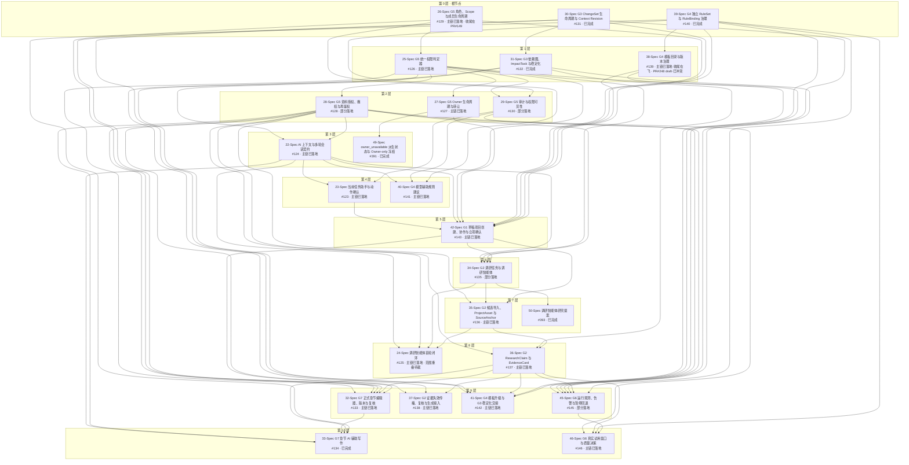

# G1–G7 Spec 完成路径图

## 口径

- **基线**：依赖图与落地判定经历三次基线：`8bb1981`（2026-10-21 下午）→ `912fb901`（同日复核：66 条原生依赖边不变；登记处声明的既有路径全部仍在 main 上；**#139 的档位由「未开工」修正为「部分落地」**——main 上已有 `internal/lingdoc/templategovernance/catalog.go`（Profile 管理）与 `workspacecore.TemplateCatalogResolver` 端口，完整的目录与版本治理在未合并的 PR#248 里）→ **`0a2fa980`（2026-10-23，#413 完整重算）**。当前所有档位、层号与 frontier 结论均以 `0a2fa980` 为准。
- **依赖快照已重算（2026-10-23，#413）**：自 `912fb901` 起，`main` 前移 **373 个提交**（`a1d817ff` → `0a2fa980`）。这期间合入了 PR #357（PF-2 动作族落地，Spec #134 关闭）、#361–#375（Spec-48 命名收口，478 个文件改名）、#388（PF-2 交面）、#390 与 #392（PF-5 / PF-4 认领）、#394 与 #400（PF-5 交付新 Spec #393）、#389 与 #418（PF-3 落地并交面）、#417 与 #423（PF-5 落地并交面）、#419 与 #422（PF-4 落地并交面）、#411（登记处一致性检测器）、#447（残留票归属与新 Spec 清单定稿）。**本图的「权威依赖表」「分层路径图」「当前 frontier」三节已按 `0a2fa980` 重算完成**。
  - **依赖边本身未受影响**：补边记录里的 23 条边依据的是 Spec 文档，不是代码文件位置，Spec-48 的改名不触及它们。**重算逐条复算，66 条既有边无一条变化**；新增 2 条（`#391 blocked_by #127`、`#393 blocked_by #135`），见文末补边记录 ⇒ **25 张 Spec / 68 条原生依赖边**。
  - **本轮重算的部分**：「权威依赖表」的票状态与落地档位（四要素静态核对：代码入口 + HTTP 路由 + 迁移 + 前端消费）、「分层路径图」的节点档位标签与层号、「当前 frontier」，三节全部按 `0a2fa980` 重跑。
  - **本图已就地更新的部分**：「施工并行面」一节的面表与认领状态（2026-10-23），因为那部分的变化是**登记处与票面的事实**而非代码落地判定。
  - **本轮新增的机器校验**（不依赖重算）：`scripts/lingdoc_manifest_baseline.py` 与 `scripts/lingdoc_ticket_ownership.py` 守住登记处与票面的实时一致性——见「施工并行面」一节。
- **依赖真相源**：GitHub 原生 `blocked_by` 关系（`GET /repos/magician336/lingdoc/issues/{n}/dependencies/blocked_by`）。本图**不**以 issue 正文或 Spec 文档的依赖描述作为依赖真相；文档声明与原生关系的差异已于 2026-10-21 统一，补边记录见文末。
- **落地判定**：代码入口 + HTTP 路由 + 迁移 + 前端消费四要素在 `main` 上齐备 = 「主链已落地」。**主链已落地 ≠ 验收通过**：它只说明该 Spec 的能力有一条可运行的路径，不说明其全部验收点成立。
- **未运行声明**：本图的落地判定是**静态存在性核对**（grep / 文件树 / 路由注册 / 迁移文件），**未运行 `go test` / `npm test`，未启动服务做端到端验证**。标注为「部分落地」的缺口是「grep 无命中」或「推断」，需定向测试确认。
- **节点**：Spec 文档（`docs/06-灵档产品开发规划/NN-Spec-*.md`）。issue 是 Spec 的发布副本兼执行票，用于状态判定，不作为独立节点。
- **分层算法**：最长路径分层，层号 = 1 + max(所有 blocker 的层号)。已关闭的 blocker 同样计入拓扑（它们在 L0/L1）。

## 权威依赖表

**25 张 Spec，共 68 条原生依赖边**（#413 重算，基线 `0a2fa980`）。

| Spec | issue | 票状态 | 原生 blocker | 落地档位 | 在飞 PR |
|---|---|---|---|---|---|
| 26-Spec G5 角色、Scope 与成员生命周期 | #129 | open | — | 主链已落地·收尾在飞 | PR#149 |
| 30-Spec G3 ChangeSet 生命周期与 Context Revision | #131 | closed | — | 已完成 | — |
| 39-Spec G4 独立 RuleSet 与 RuleBinding 治理 | #140 | closed | — | 已完成 | — |
| 25-Spec G5 统一权限判定器 | #126 | open | #129 | 主链已落地 | — |
| 31-Spec G3 依赖图、ImpactTask 与稳定化 | #132 | closed | #131 | 已完成 | — |
| 38-Spec G4 模板目录与版本治理 | #139 | open | #140 | **主链已落地·收尾在飞** | PR#248（draft，**已与 main 冲突**） |
| 27-Spec G5 Owner 生命周期与转让 | #127 | open | #126 | **主链已落地** | — |
| 28-Spec G5 资料授权、撤权与再鉴权 | #128 | open | #126 | **部分落地**（↓ 降档，见下） | — |
| 29-Spec G5 审计与权限可见性 | #130 | open | #126, #129 | 部分落地 | — |
| 22-Spec AI 上下文与多轮会话契约 | #124 | open | #126, #128 | **主链已落地** | — |
| 23-Spec 当前任务助手与动作确认 | #123 | open | #124, #130 | **主链已落地** | — |
| 40-Spec G4 模型辅助规则建议 | #141 | open | #124, #130, #140 | 主链已落地 | — |
| 42-Spec G1 草稿项目创建、协作与立项确认 | #143 | open | #123, #124, #126, #127, #129, #131, #139, #140 | 主链已落地 | — |
| 34-Spec G2 调研任务与调研智能体 | #135 | open | #124, #126, #128, #143 | 部分落地 | — |
| 35-Spec G2 候选导入、ProjectAsset 与 SourceAnchor | #136 | open | #128, #135, #143 | 主链已落地 | — |
| 24-Spec 调研智能体首轮闭环 | #125 | open | #124, #128, #135, #136 | **主链已落地** | — |
| 36-Spec G2 ResearchClaim 与 EvidenceCard | #137 | open | #128, #132, #136 | 主链已落地 | — |
| 32-Spec G7 正式章节编辑器、版本与复核 | #133 | open | #126, #128, #129, #131, #137, #143 | 主链已落地 | — |
| 37-Spec G2 证据失效传播、复核与生成接入 | #138 | open | #128, #132, #137 | 主链已落地 | — |
| 41-Spec G4 模板升级与 G3 稳定化交接 | #142 | open | #131, #132, #137, #139, #140 | **主链已落地** | — |
| 45-Spec G6 运行观测、告警与暂停回退 | #145 | open | #126, #128, #130, #131, #132, #137, #140 | 部分落地 | — |
| 33-Spec G7 章节 AI 辅助写作 | #134 | closed | #124, #128, #133, #137, #140 | 已完成 | — |
| 46-Spec G6 真实试用窗口与质量决策 | #146 | open | #128, #137, #140, #145 | **主链已落地** | — |
| **49-Spec owner_unavailable 派生状态与 Owner-only 冻结** | **#391** | **closed** | **#127** | **已完成** | — |
| **50-Spec 调研智能体研究提案** | **#393** | **closed** | **#135** | **已完成** | — |

### 本轮档位变化（#413 重算，共 11 张变）

**升档 8 张**：

- **#123 / #124 / #125**（部分落地 → 主链已落地）——四要素齐备：代码入口（`agent_research_model.go` / `agent_action_service.go` 的 `ActionProposal` / `AgentContextPackage` / `ResearchTask` / `ResearchRun` / `ImportCandidate`）、HTTP 路由（`workspace/agent_routes.go`）、迁移（`000037` / `000116` 的 `lingdoc_g2_objects`）、前端消费（`agentApi.ts` + `ResearchPanel.vue`）。
- **#127**（部分落地 → 主链已落地）——PF-4 落地 `owner_unavailable` 派生判定后，转让 / 拒绝 / 可用性四要素在 main 上齐备（`owner_unavailable.go`、`membership/results.go`、`000028` / `000107` 迁移、`collaboration.ts` + `ProjectCollaborationPanel.vue`）。
- **#139**（部分落地 → **主链已落地·收尾在飞**）——main 上四要素已齐备（`templategovernance/catalog.go`、profiles 路由全套、`000037` / `000116`、`templateGovernance.ts` + `TemplateGovernancePanel.vue`）；剩余收尾（`ListAuditHistory`、`GET /template-catalog/profiles/:templateId/audit-events`、`catalog_http_parity_test.go`、`TemplateGovernancePanel.test.ts`）**只在未合并的 draft PR #248 里**，main 上 grep 无命中。
- **#142**（部分落地 → 主链已落地）——模板升级 ChangeSet、影响分类、ImpactTask 路由与前端预览均已在 main。
- **#146**（部分落地 → 主链已落地）——PF-1 的 G6 试用前端随 PR #381 合入，窗口 / 样本 / 统计 / 决策 / 签署全部有界面。

**降档 1 张**：

- **#128 主链已落地 → 部分落地**。28-Spec 的 Implementation Decisions 明文要求「Store project–knowledge-base binding with project, tenant, KB, binder, binding version and allowed purpose」，而实测 `binding_version` / `AllowedPurpose` / `BoundKnowledgeBase` / `KnowledgeBaseBind` 在 `internal/lingdoc` 与 `migrations` 下**零命中**——全仓命中只有 `internal/sandbox/` 的**沙箱会话绑定**（`SessionSandboxBindingVersion`，属完全不同的领域）。⇒ 「项目—知识库绑定」的存储与迁移在 main 上不存在，四要素缺迁移这一项。

**新节点 2 张**（此前不在 23 张计数里，本次一并纳入）：

- **#391**（49-Spec，PF-4 交付，closed，已完成）——`owner_unavailable.go`、`project_archive.go`、GET `/owner-availability` 与 POST `/archive`、`000053` / `000132` 迁移、`useOwnerAvailability.ts` + `OwnerUnavailableNotice.vue` / `ProjectArchivePanel.vue` 四要素齐备。
- **#393**（50-Spec，PF-5 交付，closed，已完成）——`research_proposal.go` 的契约与解码、复用既有 turn 端点、提案随载荷走故无新表、`ResearchPanel.vue` 的 task_card / 候选来源 / 理由 / 缺口渲染。


## 分层路径图

箭头 = 原生 `blocked_by` 方向（先做 → 后做）。层号 = 最长路径分层，层号越大越晚。



## 关键路径

最长链 **10 跳、11 层**（重算后不变——新增的 #391 / #393 两个节点各自只引入 **2 跳**的短链：`#126 → #127 → #391` 与 `#143 → #135 → #393`），**穿过两张原生「看起来不是根」的 Spec**：

```
#129 → #126 → #128 → #124 → #123 → #143 → #135 → #136 → #137 → #133 → #134
```

- `#128`（资料授权、撤权与再鉴权）在原生关系里只有一条 blocker（#126），看起来像次要节点；它实际上有 **10 条出边**，是第二道总闸门。
- `#133`（G7 正式章节编辑器）同时被 #143（G1 立项）与 #137（G2 主张与证据卡）挡住，而这两张在补边前的原生图里与它毫无关系。
- 第二条同样长的链：`#139 → #143 → #135 → #136 → #137 → #133 → #134`。

## 依赖边的语义分档

**依赖边 ≠ 施工顺序。** 这条必须先说清楚，否则 11 层 68 条边会被读成「只能一条线走」。

判据：**下游写代码时，是否必须知道上游的「具体行为」（状态取值、失败模式、接口语义），而不只是上游的「契约」。**

| 档 | 含义 | 边数 | 实例 |
|---|---|---|---|
| **① 接口未冻结** | 下游连契约都没有，必须等上游设计 | **0** | 所有相关 Spec 文档都已写明契约 |
| **② 行为未稳定** | 契约有，但上游行为未定义或还会变，下游写了要返工 | **0** | **已清零**（见下） |
| **③ 验收未满足** | 上游行为已定，下游可独立实现，只是最终验收要等上游端到端链路 | **68** | 全部 |
| ② 待定 | 取决于上游剩余工作是「补缺口」还是「改行为」 | **0** | **已定档**（见下） |

**② 档已清零（2026-10-23 重算）**：原来唯一一条 ② 档边是 `#127 → #143`——`owner_unavailable` 状态串全仓不存在，上游行为不是「未稳定」而是**未定义**，下游写不出「Owner 不可用时不能立项」这个分支。**PF-4 交付的 49-Spec（#391）已把该行为定义并实现**（`internal/lingdoc/workspacecore/owner_unavailable.go`），#391 的 Further Notes 原话是「本面解开 #127 → #143 这条 66 条原生依赖里唯一一条『行为未稳定』级的实现依赖」⇒ 该边降为 **③ 档**。**现在全部 68 条边都是「契约已冻结、下游可独立开工」档。**

**「② 待定」那条已定档**：#135 → #125。原判据是「#135 的剩余工作含**新增** research purpose——如果它改写现有调研任务的行为，#125 就要跟着改；如果是纯新增，#125 不受影响。待 PF-5 落地后确认」。**PF-5 已落地**（PR #417 / #423，交付 50-Spec #393 研究提案契约），#135 的剩余工作收敛为 #335（外部检索渠道走不到 + provider 失败原因不落日志）——那是**修 bug 与补日志**，不改调研任务模型的行为 ⇒ **#125 不受影响，该边定档为 ③**。

### 为什么边不能直接当施工顺序：三条证据

1. **#143（G1 立项）主链已落地，而它的 blocker 之一 #139（G4 模板目录）的收尾至今只在未合并的 draft PR #248 里**（`ListAuditHistory` 与 `GET /template-catalog/profiles/:templateId/audit-events` 在 main 上 grep 无命中）。若边=施工顺序，这个事实不可能出现。
2. **13 张 Spec 主链已在 `main`（#123 #124 #125 #126 #127 #133 #136 #137 #138 #141 #142 #143 #146），而它们的 blocker 无一例外全部还开着**——一张例外都没有。
3. **24-Spec 与 34-Spec 各自都自称「第一条切片」**，34/35/36/37-Spec 本身就被设计成四片。

结论：**③ 档的解锁条件不是「上游写完」，而是「契约冻结」。** 这正是 Ousterhout 说的「先写接口」——先把拥有真相的模块的契约与不变量定下来，下游就能对着契约开工。

## 当前 frontier

| 票 | Spec | 状态 |
|---|---|---|
| #129 | 26-Spec G5 角色、Scope 与成员生命周期 | open，无 open blocker，**已被 lzmp666 认领**，PR#149 在飞 |
| #139 | 38-Spec G4 模板目录与版本治理 | open，无 open blocker，**已被 lzmp666 认领**，PR#248 在飞（draft） |

按 wayfinder 的 frontier 定义（open + 无 open blocker + **未认领**），**G1–G7 线当前没有未认领的 frontier 票**。

**重算确认（#413，25 张全查）**：**25 张 Spec 里只有 #129 与 #139 两张 open 且无 open blocker**，而**两张都已被 lzmp666 认领**。结论与上一版一致，但这次是**查了 25 张**得到的——不是「只剩两张没查」，是「查了 25 张，开放无阻塞的就这两张，且都被认领」。#391 / #393 虽是新节点，但两张都 closed，不进 frontier。

**与登记处对齐**：登记处（`scripts/lingdoc_parallel_surfaces.py`）**十个面**中 **PF-1 ~ PF-6、PF-8 与 PF-10 均为 `done`**（PF-6 于 2026-10-23 随 PR #443 合入 `main`，合并提交 `52f5b615`；PF-10 是 Beta 首版验收证据生产面，交付 #451 / #452 / #453，随 PR #474 合入 `main`）；**PF-7（#460）为 `available`、PF-9（#461）为 `claimed`**（PF-9 于 2026-10-23 由 magician336 认领并施工；上游是既有且已冻结的 Spec #130 / #127 ⇒ 今天就能开工）。**矛盾 C1 已消除**：此前「#330 票面写已认领、登记处仍记 `available`、PR #443 在飞」的三方不一致，随 #443 合入 main 与 PF-6 交面（登记处 `status` 改 `done`、`claimed_by` 清空）一并解决。（**2026-10-23 另立 PF-8**：#382 / #383 / #384 由 PF-8 一次交付，登记处现有**十个面**，见下面的「当前的十个面」；PF-8 交付的 Spec #145 / #146 仍是 open，不改变这里的 frontier 结论。）

两张在飞 PR：

| PR | head | 票 | checks | mergeable | 备注 |
|---|---|---|---|---|---|
| #149 | `cdac79d` | #129 | 全绿 | **DIRTY（与 main 冲突）** | main 已前移 81 个提交，它未并基线；36 文件 +1605/-90；main 上是 #129 的早期不完整版本 |
| #248 | `f9c96bf` | #139 | 全绿 | **DIRTY（与 main 冲突）** | draft；已有 2 次 CHANGES_REQUESTED；main 已前移 81 个提交，它未并基线 |

## 状态词表

单一四档装不下真实情况，状态按 **票状态 × 代码证据** 两个维度合成：

| 档位 | 票 | 代码 | 本图实例 |
|---|---|---|---|
| **已完成** | closed | 在 main | #131 #132 #140 #134 **#391 #393** |
| **主链已落地·收尾在飞** | open | 主链在 main，收尾在未合并 PR | #129 **#139** |
| **主链已落地** | open | 四要素齐备 | #123 #124 #125 #126 #127 #133 #136 #137 #138 #141 #142 #143 #146 |
| **部分落地** | open | 部分验收点缺 | #128 #130 #135 #145 |
| **未开工** | open | main 无对应落点 | 本图无实例（保留为守护档） |
| **已关未落地** | closed | **不在 main** | 本图无实例（见下） |

**「已关未落地」在本图内没有实例，但它是真实发生过的异常**：Spec #47 线上的 #262（47.06 错误形态跨面归并）、#271（47.03 章节「已确认」单一谓词）、#263（47.07 旧错误平表 contract）三张票在 2026-10-20 12:16–12:17 被手动关闭，但当时 `workspacecore.ChapterConfirmed`、`internal/clienterror/catalog.go` 与 47.07 的守护测试在 `main` 上均不存在，代码只锁在未合并的 PR#293 里。

> **该状态已于 2026-10-21 21:00 前后解除**：PR#293 合入 `main`（`633ba347`），上述三个产物现在都在 `main` 上（`internal/lingdoc/workspacecore/chapter_confirmation.go`、`internal/clienterror/catalog.go`、`internal/lingdoc/workspace/client_form_convergence_test.go`）。**保留该档位作为守护样本**——它证明「票关了但代码没进 main」是真实会发生的，而不是理论风险。

## 施工并行面

依赖图回答「顺序对不对」，**并行面回答「今天开什么」**。两者的登记处不同：

- **依赖图**（本文件 + 原生 `blocked_by`）= 顺序与验收依赖，快照性质。
- **施工并行面登记处** = [`scripts/lingdoc_parallel_surfaces.py`](https://github.com/magician336/lingdoc/blob/main/scripts/lingdoc_parallel_surfaces.py) = **活的状态与文件所有权**，按门禁面清单的同款形态维护（declarative + loader 校验 + 守护测试）。它放在 `scripts/` 而不是 `scripts/ci/`，因为 `scripts/ci/` 是门禁判定层，必须保持「只有一个模块回答『什么会跑』」；登记处回答的是另一个问题——「谁可以碰哪些路径」。

### 为什么要有登记处

两个面碰同一个文件，并行就会互相覆盖；而这种撞车在合并前看不出来。登记处把**文件所有权**变成可执行约束：任何两个面的路径集重叠，登记处直接拒绝加载并以非零退出，守护测试 `scripts/ci/test_lingdoc_parallel_surfaces.py` 守住这条不变量（随 `lingdoc-review.yml` 的 `test_lingdoc_*.py` 自动进 CI）。

### 当前的十个面

每个面在 tracker 上有一张自己的票（**票是执行单元，Spec 是交付单元**），票已挂成对应 Spec 票的 GitHub 子票。

| 票 | 面 | 交付（Spec） | 文件所有权 | 零阻塞理由 |
|---|---|---|---|---|
| [#325](https://github.com/magician336/lingdoc/issues/325) | **PF-1** G6 运维与试用前端 | #145 #146 | **路径集以登记处为准**（本面 2026-10-22 认领时为 5 条：`frontend/src/views/lingdoc/ImpactOpsPanel.vue`、`runtimeMetrics.ts`、`runtimeMetrics.test.ts`、`frontend/src/api/lingdoc/mainlineChanges.test.js`、`frontend/src/views/lingdoc/ImpactOpsPanel.test.js`；**2026-10-23 交面后只剩 1 条**——本面自己的方案档 `G6-运维前端-指标视图与契约-20261022.md`，原五个前端路径已移交 PF-8） | 后端 16 条路由与前端 G6 客户端都已在 main 上（`internal/lingdoc/workspace/impact_routes.go:135-182`、`api/lingdoc/mainlineChanges.ts:112-127`）；本面只补服务端已给但界面未呈现的运行指标，并给前端补契约保护 |
| [#326](https://github.com/magician336/lingdoc/issues/326) | **PF-2** G7 AI 动作族 | #134 | **路径集以登记处为准**（本面 2026-10-22 补齐到 **55** 条：新增 `internal/lingdoc/writingaction/`、`internal/lingdoc/candidateadoption/`、`internal/lingdoc/generation/`，`internal/lingdoc/workspace/` 下的选段改写与评审执行方，`internal/clienterror/catalog.go`，前端动作面板 / 评审报告面板 / 动作表客户端等；**2026-10-23 一条路径一次性移交给 PF-8**：`internal/router/lingdoc_routes_test.go` —— PF-8 在 PR #446 里给它加了一条注释，而登记处的重叠检查是路径级的，改了别面的路径就必须显式移交 ⇒ 本面 **54** 条） | **已于 2026-10-22 完成**：十四张施工票 + 集成步已随 PR #357 合入 `main`（合并提交 `c4c9ac93`），Spec #134 随之关闭；残留票 #385 / #386 保持开放 |
| [#327](https://github.com/magician336/lingdoc/issues/327) | **PF-3** 审计告警接线与 AuditEvent 字段 | #130 | **路径集以登记处为准**（本面 2026-10-23 补齐到 **17** 条：`internal/lingdoc/workspacecore/{model,machine_read_grant,service}.go`、`audit_failure_alert_test.go`、`audit_event_version_fields_test.go`、`pr150_migration_history_test.go`、`internal/lingdoc/membership/fixture_test.go`、`internal/lingdoc/workspace/{audit_event_table_fixture_test.go（新增）,change_set_http_test.go,change_set_delivery_test.go,delivery_http_test.go,save_chapter_policy_test.go}`、`internal/container/lingdoc_ruleset_delivery_e2e_test.go`、`migrations/sqlite/000052_lingdoc_audit_version_fields.*`、`migrations/versioned/000131_lingdoc_audit_version_fields.*`）**本面让出 `workspacecore/service_facade.go` 与 `workspacecore/typed_contracts.go`**：PF-4 于 2026-10-22 先在 main 上声明了它们（PR #392）且仍是待施工面，登记处要求一条路径只有一个拥有者；但 **PF-3 确实改了这两个文件**（readWithAudit 接缝与 Authorize/GetProject 接线在 `service_facade.go`，AuthorizeRequest 接线在 `typed_contracts.go`），两面的改动由基线合并组合在同一棵树上、合并零冲突，PF-4 之后动这两个文件时冲突会显式报出来。**2026-10-23 本面再让出 `workspacecore/runtime_control.go` 给 PF-8**：#383 的运行控制回退动作要落在同一个文件里（回退目标挂在控制项上、白名单加 `rollback`），而 PF-8 是正在施工的那一面；登记处的重叠检查是路径级的（不看 status、不看改动行），两边同时声明就直接拒绝加载。本面在 main 上已交付的 #327 内容（`EmitAuditFailureAlert` 与 `AuditEvent` 的两个独立列）原样保留，不受这次移交影响。**2026-10-23 再永久移交三条给 PF-7**（`workspacecore/model.go`、`workspacecore/service.go`、`membership/fixture_test.go`）——依据票 #415（`AuditEvent` 声明字段与落库列一致、读侧角色过滤生效），PF-7 = [#460](https://github.com/magician336/lingdoc/issues/460)；本面已交面且不再需要这三条 ⇒ **不归还** ⇒ 路径集 17 → 14 条 | **已于 2026-10-23 完成**：读类审计失败接入 G6 告警源（`EmitAuditFailureAlert` 发 `Category=audit` 的运行事件并被告警规则命中）+ `AuditEvent` 补 `target_version` / `project_revision` 两个一等字段并真正落库（`sqlite/000052`、`versioned/000131`），随 PR #389 合入 `main`（合并提交 `5c31fc9b`），票 #327 随之关闭；验收 AC-327-01…17 全 PASS（证据 `T327-验证报告.json`），合并前健康度复评 `H_L` 64.4 / `F_R` 65.0。**残留票保持开放**：[#387](https://github.com/magician336/lingdoc/issues/387)（PostgreSQL 上普通读的 fail-open 不成立）、[#414](https://github.com/magician336/lingdoc/issues/414)（平台事务外通道写失败恒返回 nil）、[#415](https://github.com/magician336/lingdoc/issues/415)（`AuditEvent` 声明字段与落库列不一致）、[#416](https://github.com/magician336/lingdoc/issues/416)（夹具自持生产 schema 形状的机制治理）。**Spec #130 保持开放**：本面只交付了告警接线与两个版本字段，角色过滤查询等其余验收点未交付 |
| [#328](https://github.com/magician336/lingdoc/issues/328) | **PF-4** `owner_unavailable` 状态与 Owner-only 冻结 | #127 **#391** | **路径集以登记处为准**（本面 2026-10-22 认领时为 17 条，2026-10-23 实现合入前实测补齐到 **48** 条，**同日让出四个路径给 PF-8、PF-8 合入 main 后又归还 ⇒ 现为 47 条**；另有一条路径一次性移交给 PF-8：判定内核 `workspacecore/owner_unavailable.go` 替代已删除的 `owner_transfer_proof.go`、冻结与归档出口（`workspacecore/`、`membership/`）、错误层 `clienterror/clienterror.go`、契约与路由（含四张票各自的 HTTP 断言文件）、归档迁移 `sqlite/000053` 与 `versioned/000132`、前端 composable 与三个面板；**完整清单只在登记处 `scripts/lingdoc_parallel_surfaces.py` 里维护**）**2026-10-23 经维护者裁决，本面让出四个路径给 PF-8**：`workspacecore/service_facade.go`、`workspacecore/typed_contracts.go`、`workspacecore/context_ports_test.go` 与 `docs/08-本轮实施方案/contracts/openapi.json`——PF-8 要在这四处落 #382/#383 的接线（授权拒绝观测的收敛点、运行控制回退动作、窄口方法集登记与契约产物），而登记处的重叠检查是路径级的，两边同时声明就直接拒绝加载。**这四个路径已随 PF-8 合入 `main` 归还本面**；另 `internal/container/lingdoc_test.go` 因 PF-8 在 PR #446 里给它加注释而**一次性移交给 PF-8**（移交是单向的，本面不再声称拥有它）。本面在 main 上已交付的 owner_unavailable 能力不受这两次移交影响。**2026-10-23 再永久移交三条给 PF-9**（`workspacecore/owner_unavailable.go`、`membership/policy.go`、`membership/results.go`）——依据票 #420（Owner 专属入口能力 → 读出口能力的对应关系）与 #421（写侧冻结归因），PF-9 = [#461](https://github.com/magician336/lingdoc/issues/461)；本面已交面且不再需要这三条 ⇒ **不归还** ⇒ 路径集 47 → 44 条；**将来本面若要动这些路径，需人工解一次冲突**（PF-4 与 PF-8 都在授权判定附近改过代码，冲突会显式报出来） | **已于 2026-10-23 完成**：PR #419 已合入 `main`（合并提交 `2b1b098c`），票 #406–#410 与 Spec 票 #391 随之关闭。交付三件事：Owner 可用性收口到一处（判定与门面同处，并有 AST 守护测试拒绝第二份内联判定）；派生的 `owner_unavailable` 让五项 Owner 专属动作统一走同一道闸门，拒绝可归因（既有 404 与 `not_found` 不变，原因只进可选 `details.reason_code`）；归档能力落地（#127 冻结清单里原本不存在的一项）。验收 AC-49-01…10 全 PASS（证据 `T49-验证报告.json`）。**残留票保持开放**：[#420](https://github.com/magician336/lingdoc/issues/420)（权限读出口按能力聚合）、[#421](https://github.com/magician336/lingdoc/issues/421)（写侧冻结归因只在部分路径可得）；**Spec #127 与 #143 保持开放**（本面只交付各自的一部分）。解除 ② 档那条实现依赖（#127 → #143） |
| [#329](https://github.com/magician336/lingdoc/issues/329) | **PF-5** Agent research purpose | #135 #125 **#393** | **路径集以登记处为准**（本面 2026-10-22 认领时为 3 条，同日扩到 **9** 条：新增研究提案契约模块 `internal/lingdoc/workspacecore/research_proposal.go`，以及前端 `api/lingdoc/agentApi.ts`、`views/lingdoc/ResearchPanel.vue` 与它们的测试；**2026-10-23 再扩到 11 条**：#404 的词汇归一把裸字符串换成服务端常量，顺手改到了 `internal/lingdoc/workspacecore/change_draft_action.go` 与 `internal/lingdoc/workspace/template_governance_runtime.go`——这两个文件原先不被任何面拥有，所以没有所有权冲突，登记进来是为了让路径集与实际改动一致；**复审后再扩到 12 条**：新增 `frontend/src/api/lingdoc/agentApi.types.test.ts`（前端类型层的用例，防止 `task_card` 被类型成一份更严的形状而对助手轮次谎报）） | 上下文包后端已在 `agent_research_model.go` 落地，不必等 #124 的前端消费。**本面 2026-10-22 认领**，交付的新增 Spec 是 [#393](https://github.com/magician336/lingdoc/issues/393)（调研智能体的研究提案，仓内文档 `50-Spec-调研智能体研究提案.md`）。**已于 2026-10-23 完成**：PR #417 已合入 `main`（合并提交 `1b784a4f`），Spec 票 #393 与四张施工票 #401–#404 随之关闭，面票 #329 随交面 PR 关闭。交付四件事：① 研究提案的形状由一份服务端契约独占，提示词从它渲染（助手那张同名卡片按另一张卡渲染，助手提示词与 #401 之前**逐字节相同**）；② 候选来源必须对得上**该轮**的授权上下文，对不上即拒、**不降级**；③ 理由与缺口由结构强制（两个字段都必填），空话表达不出来；④ 坏提案响亮失败（`failure_code=invalid_proposal`）但**不连累那一轮的问答复**，缺提案也不打断对话；用途由服务端按会话 agent 派生，客户端不新增请求字段。验收矩阵 18 行全 PASS，引用的 26 个 Go 用例名与 11 条前端用例标题逐条复核零缺失；两轴 code-review 都判 FAIL，12 条发现与 3 处记账全部修完，按最终代码复审判 PASS（无新增 P0/P1）。**Spec #135 与 #125 保持开放**（本面只交付 research 能力里的「研究提案契约」这一部分）；#124 归 PF-6 |
| [#330](https://github.com/magician336/lingdoc/issues/330) | **PF-6** 上下文包前端消费 | #124 **#431** | **路径集以登记处为准**（本面 2026-10-23 认领时登记 4 条，施工前实测修正为 **6** 条：API 模块 `frontend/src/api/lingdoc/agentContext.ts` 及其测试、面板 `frontend/src/views/lingdoc/ContextPackagePanel.vue` 及其测试，加上本面的开发计划与验证报告；API 模块的原登记名以交付批次代号开头，违反命名登记表的 `^[gGtT]\d` 规则，已实测改正） | 后端契约已定。**2026-10-23 实测更正了票面「前端零消费」这句过时断言**：研究面板（PF-5 已交付的文件）里已有一份上下文表单与一处预览，但只显示来源定位、资料版本、模型使用许可与输出约束——**卡片、选择理由、卡片状态三样都没有**，增删之后界面从不复述服务端的组装结果。**本面 2026-10-23 由 magician336 认领**，同日补交一张 G 线 Spec [#431](https://github.com/magician336/lingdoc/issues/431)（上下文包的前端消费，仓内文档 `51-Spec-上下文包前端消费.md`）。**本面自述的四处缺口已开票承接**：[#432](https://github.com/magician336/lingdoc/issues/432)（选择理由没有结构化映射）、[#433](https://github.com/magician336/lingdoc/issues/433)（低风险状态卡免额外确认在服务端不成立）、[#434](https://github.com/magician336/lingdoc/issues/434)（研究面板里重复的上下文构造逻辑）、[#435](https://github.com/magician336/lingdoc/issues/435)（前端契约类型落后于服务端上下文包）。**本面已于 2026-10-23 完成**：PR #443 合入 `main`（合并提交 `52f5b615`），面票 #330 与施工票 #444 / #445、Spec 票 #431 随之关闭；**残留票保持开放**（#432 / #433 / #434 / #435）；**集成票 #476 保持开放**（面板挂进 Workspace + 浏览器端到端）；**Spec #124 保持开放**（本面只交付它的前端验收点） |
| [#382](https://github.com/magician336/lingdoc/issues/382) | **PF-8** G6 告警规则与运行控制回退 | #145 #146 | **路径集以登记处为准**（**28** 条：后端 `workspacecore/{runtime_alert_rule,runtime_observation,runtime_control,permission_policy,context_ports,operation_pipeline}.go` 与三个新测试文件、`workspace/impact_routes.go`、`router/lingdoc_routes_test.go` 与 `container/lingdoc_test.go`；前端 `api/lingdoc/{runtimeControl,trialWindow,mainlineChanges}.ts` 与 `views/lingdoc/{RuntimeOpsPanel.vue,ImpactOpsPanel.vue,runtimeMetrics.ts}` 及各自测试；两份方案档 + README 索引 + 路径图）**其中六个路径是从已交面的面移交过来的**：`workspacecore/runtime_control.go`（原 PF-3）、`views/lingdoc/{ImpactOpsPanel.vue,ImpactOpsPanel.test.js}`、`runtimeMetrics.{ts,test.ts}` 与 `api/lingdoc/mainlineChanges.test.js`（原 PF-1）、`router/lingdoc_routes_test.go`（原 PF-2）与 `container/lingdoc_test.go`（原 PF-4）——登记处的重叠检查是路径级的，两边同时声明就直接拒绝加载；**2026-10-23 交面**：本面从 PF-4 借来的四个路径（`service_facade.go` / `typed_contracts.go` / `context_ports_test.go` / `contracts/openapi.json`）随 PR #446 合入 main 后归还 PF-4，本面路径集 30 → 28 条 | **一次交付 #382 / #383 两张后端票，另加 #384 的前端部分**：#382 告警规则可读回（`GET /runtime/alert-rules`）与可停用 / 可启用 / 可更新（`POST /runtime/alert-rules/:ruleId/actions`），停用后的规则不再产生告警；授权拒绝落成 `permission/deny` 运行事件（**只进事件流、不触发告警**——告警规则的 `pause` 动作会直接暂停整个课题）；#383 运行控制新增 `rollback` 动作，回退经既有 `reverseChangeSet` 领域入口执行，停止新写入并记录回退目标（**「切回已验证配置」这一半不在本面范围**）。**#327 已由 PR #389 在 main 上完成并关票，本面不重复交付**：审计版本两列与读类审计失败接告警源都在 main 上，本面只删掉自己那份重复实现。方案档：`G6-运行控制后端补齐-20261023.md`（后端）与 `G6-运维面板独立化-20261023.md`（前端）。**2026-10-23 由 magician336 认领并完成**（登记处 `status=done`） |
| [#460](https://github.com/magician336/lingdoc/issues/460) | **PF-7** 审计链完整性 | #130 | **路径集以登记处为准**（**10** 条：从 PF-3 永久移交的 `workspacecore/{model,service}.go` 与 `membership/fixture_test.go`、无主的 `internal/container/lingdoc.go`、本面新增迁移 `migrations/sqlite/000054_lingdoc_audit_decision_fields.*` 与 `migrations/versioned/000133_lingdoc_audit_decision_fields.*`、#454 的两半守护 `internal/database/audit_event_columns_test.go` 与 `scripts/ci/test_lingdoc_fixture_schema_source.py`）| **未认领（`available`）**：交付票 #414 / #415 / #454；交付 Spec 是既有的 #130，不新开。上游契约已冻结 ⇒ ③ 档「验收未满足」，**没有 `blocked_by` 边，今天就能开工**。**#454 与本面合并的机制理由**：56-Spec 决策 3 把「模型字段集合 == 表列集合」的守护定在 `internal/database/`；若 #415 另在 `workspacecore/` 写一份，同一条不变量就有两个 module 各写一遍（ch05 信息泄漏）⇒ 合成一个面后守护只有一份 |
| [#465](https://github.com/magician336/lingdoc/issues/465) | **PF-10** Beta 首版验收证据生产 | #451 #452 #453 | **路径集以登记处为准**（**17** 条：`workspacecore/model_call_ledger{,_test}.go`、`workspace/agent_model.go`、两方言迁移 `sqlite/000055` 与 `versioned/000134`、`scripts/acceptance/{beta_evidence,beta_evidence_parity,beta_http_readback}.py`、`scripts/acceptance/beta_browser_cdp.mjs`、`scripts/ci/test_lingdoc_beta_evidence.py`、`scripts/lingdoc_mock/run_f01.py`、`scripts/acceptance/lingdoc_full_server_restart.py`、`contracts/workflow.json`、`internal/database/migration_sqlite_versioned_schema_test.go`、证据目录 `acceptance/beta-first/`（目录级）） | **2026-10-23 由 magician336 认领并完成**：把 Beta 首版真实验收从人肉变成一条可复跑命令——① **#453 模型调用账本**（一张 `lingdoc_model_call_ledger` 表，`kind` 分 `call` / `switch` 两行种；两方言迁移 + Go 行结构 + 10 个用例；账本装进组合根，不装账本在生产里就是死的）；② **#452 浏览器 × 后端对偶执行器**（编排器 + HTTP 侧 + CDP 浏览器侧三个独立 CLI + 32 条守护测试；**真实后端 + 真实 Vite + 真实 Edge 无头跑通**，10 项在「浏览器 == HTTP == 刷新后读回」三个快照上逐项相等，注入不一致能红）；③ **#451 验收执行器与证据目录**（`run_f01.py` 扩**六个**领域断言 check kind——`ref_in` / `marked_or_absent` / `version_bound` / `readback_equals` / `hash_equals` / `non_empty`，契约共 50 条 check、六件产物一次性产出、脱敏守护、协议三态一字不改）。**路径归属的两处刻意处置**：组合根 `internal/container/lingdoc.go` 的 owner 仍是 PF-7，本面**借用**它（只改装账本那一行），**本面合入 main 后归还**；这笔借用**在登记处 PF-10 与 PF-7 两侧都已记录**（PF-7 侧见 PR #475 / commit `60ae2dca`）；55-Spec 决策 5 的**词表收口整体未做**（`candidate_shape.go` 在 PF-2 的目录级声明内、`runtime_control.go` 属已交面的 PF-8）⇒ 本面复用既有 `run_mode` 取值、**不新增第三套词表**。 |
| [#461](https://github.com/magician336/lingdoc/issues/461) | **PF-9** Owner 冻结归因 | #127 | **路径集以登记处为准**（**8** 条：从 PF-4 永久移交的 `workspacecore/owner_unavailable.go` 与 `membership/{policy,results}.go`；**2026-10-23 再从 PF-4 永久移交两张 Owner 路由断言** `internal/router/routes_lingdoc_owner_read_outlet_test.go` 与 `internal/router/routes_lingdoc_owner_409_test.go`；本面新增 `workspacecore/owner_capability_registry{,_test}.go` 与 `membership/owner_bypass_test.go`）**实测更正了指派里的三处前缀**：原写的 `internal/lingdoc/router/…` 指向一个**不存在的目录**，真实位置是 `internal/router/`，那三个文件由 PF-4 拥有 ⇒ 按「路径在两面之间移交是合法的、单向的」与棘轮「done 面可释放路径」，两张断言文件归本面，`internal/router/routes_lingdoc.go` 留在 PF-4（本面不改它）⇒ PF-4 44 → 42 条、本面 9 → 8 条；三条错前缀路径属「悬空登记」（基线里只有声明、没有实体文件），撤回它不算路径损失 ⇒ 棘轮不拦。**异议已记在票面 #461 与 PR 正文** | **已由 magician336 认领并施工**（2026-10-23，登记处 `status=claimed` / `claimed_by=magician336`）：交付票 #420 / #421；交付 Spec 是既有的 #127，不新开。交付两件事：① **「Owner 专属入口能力」的枚举收口到一处**（`workspacecore/owner_capability_registry.go`），`OwnerOnlyCapability` 由它派生而不是内联 switch；守护测试用 go/ast 扫 `internal/lingdoc/` 全树，把「取 Owner-only 决策的函数」与登记表**双向**比对——代码里有而登记表没有 ⇒ 报「这条入口的冻结读不到」，登记表有而代码里没有 ⇒ 报「白登记」，且守护自证会红。② **转让这条 Owner 专属写路径此前不在冻结闸门内**：身份已失效的 Owner 仍能发起转让（实测 HTTP 201、status=pending），被拒时也只有朴素 `not_found`——现在两种转让形状都先过同一道闸门（判定仍只有一份，导出给 membership 包复用），拒绝带 `owner_unavailable`，租户 Owner 的旁路恢复不受影响。四种身份失效形态的 HTTP 拒绝形态落成断言（`TestOwnerUnavailableRefusalShapePerLapseForm`）。证据 `T461-验证报告.json`（9 PASS + 4 记账，含 2 条 NOT RUN 与机器可读解除条件）。**残留票**：租户侧收回身份形态的写侧归因（落在 transport 层，需对外契约变更 ⇒ 需 Spec 变更）另落开放票 |

六张票都标 `ready-for-agent`。**#325（PF-1）、#326（PF-2）、#327（PF-3）已被 magician336 认领并完成**（登记处 `status` 均为 `done`；完成态不保留 `claimed_by`，认领与完成的人记在 `summary` 里）：PF-1 于 2026-10-22 完成，**PF-2 同日完成**——十四张施工票 + 集成步已随 PR #357 合入 `main`（合并提交 `c4c9ac93`），Spec #134 随之关闭，#326 及下面 17 张票全部关闭。两张残留票保持开放：[#385](https://github.com/magician336/lingdoc/issues/385)（动作表按目标范围给动作、执行按管道分）、[#386](https://github.com/magician336/lingdoc/issues/386)（两处手抄迁移子集夹具）。**PF-3 于 2026-10-23 完成**——读类审计失败接入 G6 告警源 + `AuditEvent` 补两个版本字段，随 PR #389 合入 `main`（合并提交 `5c31fc9b`），票 #327 随之关闭；四张残留票保持开放：[#387](https://github.com/magician336/lingdoc/issues/387)、[#414](https://github.com/magician336/lingdoc/issues/414)、[#415](https://github.com/magician336/lingdoc/issues/415)、[#416](https://github.com/magician336/lingdoc/issues/416)；**Spec #130 保持开放**（本面只交付了告警接线与两个版本字段）。**#328（PF-4）也已被 magician336 认领并完成**（登记处 `status=done`；实现契约见 Spec [#391](https://github.com/magician336/lingdoc/issues/391)，仓内副本 `docs/06-灵档产品开发规划/49-Spec-owner_unavailable派生状态与Owner-only冻结.md`）；**2026-10-23 PR #419 已合入 `main`（合并提交 `2b1b098c`），票 #406–#410 与 Spec 票 #391 随之关闭**，登记处路径集同步补齐到 48 条（同日让出四个路径给 PF-8、PF-8 合入 main 后归还 ⇒ 现为 47 条）。**残留票保持开放**：[#420](https://github.com/magician336/lingdoc/issues/420)、[#421](https://github.com/magician336/lingdoc/issues/421)；**Spec #127 与 #143 保持开放**（本面只交付各自的一部分）。**#329（PF-5）也已被 magician336 认领并完成**（登记处 `status=done`；完成态不保留 `claimed_by`，认领与完成的人记在 `summary` 里）；**2026-10-23 PR #417 已合入 `main`（合并提交 `1b784a4f`），Spec 票 #393 与四张施工票 #401–#404 随之关闭**，登记处路径集 12 条。**Spec #135 与 #125 保持开放**（本面只交付 research 能力里的「研究提案契约」这一部分）。**#330（PF-6）也已被 magician336 认领并完成**（登记处 `status=done`；实现契约见 Spec [#431](https://github.com/magician336/lingdoc/issues/431)，仓内副本 `docs/06-灵档产品开发规划/51-Spec-上下文包前端消费.md`）；**2026-10-23 PR #443 已合入 `main`（合并提交 `52f5b615`），票 #330 与施工票 #444 / #445、Spec 票 #431 随之关闭**，登记处路径集 6 条（两个实现文件 + 两个测试文件 + 本计划 + 验证报告）。**残留票保持开放**：[#432](https://github.com/magician336/lingdoc/issues/432)、[#433](https://github.com/magician336/lingdoc/issues/433)、[#434](https://github.com/magician336/lingdoc/issues/434)、[#435](https://github.com/magician336/lingdoc/issues/435)；**集成票 [#476](https://github.com/magician336/lingdoc/issues/476) 保持开放**（面板挂进 Workspace + 浏览器端到端——原记在已关闭的 #384 上）；**Spec #124 保持开放**。**认领状态以登记处为准**。

**#382（PF-8）于 2026-10-23 由 magician336 认领，登记处 `status=claimed`、`claimed_by=magician336`**——一次交付三张票：#382（告警规则可读回与可停用 + 授权判定可观测）、#383（运行控制回退端点）与 #384（G6 运维面板独立化，前端部分）。**#327 不在其中**：该票已由 PR #389 在 main 上完成并关票，本面删掉自己那份重复实现（审计版本两列走 details_json 的写法、`recordAccessAuditFailOpen` 接缝、`audit/failed` 观测与组合根 sink 改动），沿用 main 上的 `AuditEvent` 两个独立列、`EmitAuditFailureAlert` 与 `readWithAudit`。本面从**四个**已交面的面手里接过**八个路径**（PF-3 的 `runtime_control.go`、PF-1 的五个前端路径、PF-2 的 `router/lingdoc_routes_test.go`、PF-4 的 `container/lingdoc_test.go`——**接的顺序与依据票见下面「已交面 ≠ 路径被独占」那条**），**从 PF-4 借来的另外四个路径已随本面合入 main 归还 PF-4**。方案档：[`G6-运行控制后端补齐-20261023.md`](G6-运行控制后端补齐-20261023.md) 与 [`G6-运维面板独立化-20261023.md`](G6-运维面板独立化-20261023.md)。**2026-10-23 随 PR #446 合入 main，登记处 `status` 改 `done`、`claimed_by` 清空**（交面与实现同一个 PR：登记处描述的就是这棵树，而 main 此刻每几分钟就前移一次，另开一张交面 PR 只会让「面已完成」这件事多等一个 CI 周期）。
**与 [`PF6之后的下一批开票定稿.md`](PF6之后的下一批开票定稿.md)（PR #447，2026-10-23）的关系**：那份定稿把 #384 判为「等候选 1（编号 52，工作台入口与面板路由模型）开票 **且** 等 PF-6（PR #443）落地之后」再开工，理由是 #384 要动保留路径 `Workspace.vue`。**本轮按维护者显式授权提前交付**（只在 `Workspace.vue` 加 G6 面板的挂载位，**不重构**该文件）⇒ PF-6 与候选 1 的执行者必须知道两件事：① `Workspace.vue` 里已经有 `'operations'` 这个面板成员与它的挂载位，两边都改这一个文件时**冲突会显式报出来**，不会静默覆盖；② 候选 1 的「面板可注册」模型要把这个已有的 `'operations'` 成员**收编**进去，而不是另起一套。定稿里「#384 blocked_by 候选 1」那条边**没有加**：本票已交付，加一条指向未开票的依赖会让一张已完成的票永远显示为被阻塞。

**2026-10-23 新增两个面**（登记处已声明，均为 `available`）：**PF-7 审计链完整性**（面票 [#460](https://github.com/magician336/lingdoc/issues/460)，交付 #414 / #415 / #454，交付 Spec #130）与 **PF-9 Owner 冻结归因**（面票 [#461](https://github.com/magician336/lingdoc/issues/461)，交付 #420 / #421，交付 Spec #127）。两者的上游都是**既有且已冻结**的 Spec 契约 ⇒ ③ 档「验收未满足」，**没有 `blocked_by` 边，今天就能开工**。路径所有权的移交：PF-7 从 PF-3 接过三条、PF-9 从 PF-4 接过三条，**都是永久移交**（两个旧面已交面且不再需要它们，不归还）⇒ PF-3 路径集 17 → 14、PF-4 47 → 44。

> **认领状态只在登记处维护一次。** 本段是登记处的说明副本，不逐面重述路径清单；哪一面拥有哪些路径，一律读 `scripts/lingdoc_parallel_surfaces.py`。2026-10-23 起有两条机器校验守着这件事：`scripts/lingdoc_manifest_baseline.py`（登记处相对 `origin/main` 不得回退）与 `scripts/lingdoc_ticket_ownership.py`（票面不得声称拥有另一个活面已拥有的路径）。

> **2026-10-22 新增了一张 G 线 Spec**：[#393](https://github.com/magician336/lingdoc/issues/393)「调研智能体的研究提案」，由 PF-5 交付（Spec 文档：`docs/06-灵档产品开发规划/50-Spec-调研智能体研究提案.md`）。它**尚未进入本图的依赖快照**——上面的「23 张 Spec / 66 条原生依赖边」与其分层、mermaid 节点、状态词表都按本文自述的口径（基线 `912fb901`）**待在 `main` 再次前移后重算**，所以本轮只更新了**面表**（哪个面交付哪些 Spec、路径集与认领状态），没有动依赖快照本身。登记处的 `G_LINE_ISSUES` 已把 #393 纳入，否则「面交付一张不在 G 线集合里的 Spec」会被校验直接拒收。**2026-10-23 PF-5 已完成**——PR #417 合入 `main`（合并提交 `1b784a4f`），Spec 票 #393 与四张施工票 #401–#404 随之关闭；#393 与同批的 #391 一样**仍未进入本图的依赖快照**，依赖快照的档位与边数仍按基线 `912fb901` 的口径待重算。上面「② 待定那条」（#135 → #125）写着「待 PF-5 落地后确认」——**确认条件现已具备，本面留给下游的事实是**：本面**没有改写调研任务自身的保存与运行行为**（`SaveResearchTask` / `RunResearchTask` / `CheckAssetScope` 未被改动，只作为「撤权会在调研任务那条路径上重新核对资料范围」的既成事实被引用），改动集中在 turn 端点的 purpose 派生与新增的研究提案契约（由 #393 覆盖）。**这条边的档位归属随依赖快照一并重算，本轮不手工改档位表**；#125 的验收是否需要跟着调整，由重算快照时一并判定。

> **2026-10-22 新增了另一张 G 线 Spec**：[#391](https://github.com/magician336/lingdoc/issues/391)「owner_unavailable 派生状态与 Owner-only 冻结」，由 PF-4 交付（Spec 文档：`docs/06-灵档产品开发规划/49-Spec-owner_unavailable派生状态与Owner-only冻结.md`）。它同样**尚未进入本图的依赖快照**——理由与 #393 相同（依赖快照按基线 `912fb901` 的口径，**待在 `main` 再次前移后重算**）。登记处的 `G_LINE_ISSUES` 已把 #391 一并纳入，PF-4 的 `issues` 因此写作 `(127, 391)`：前者是本面要修的 G 线 Spec，后者是本面**新交付**的 G 线 Spec。

> **2026-10-23 新增了第三张 G 线 Spec**：[#431](https://github.com/magician336/lingdoc/issues/431)「上下文包的前端消费」，由 PF-6 交付（Spec 文档：`docs/06-灵档产品开发规划/51-Spec-上下文包前端消费.md`）。它同样**尚未进入本图的依赖快照**——理由与 #393、#391 相同（依赖快照按基线 `912fb901` 的口径，**待在 `main` 再次前移后重算**）。登记处的 `G_LINE_ISSUES` 已把 #431 一并纳入，PF-6 的 `issues` 因此写作 `(124, 431)`：前者是本面要兑现的 G 线 Spec，后者是本面**新交付**的 G 线 Spec。

> **PF-6 的票面断言在 2026-10-23 认领时被实测更正**：票面写「当前前端对 `context_package` 零消费」，这句话在写票时成立，PF-5 交付之后不再成立——研究面板里已有一份上下文表单与一处预览。真实缺口不是「没有界面」，而是那处预览只显示来源定位、资料版本、模型使用许可与输出约束，**卡片、选择理由、卡片状态三样都没有**，且增删之后界面从不复述服务端的组装结果。本面因此不是「新增一个面板」这么薄：它要建立「意图（用户勾了什么）与事实（服务端组装了什么）分开、事实只由预览结果刷新」这条规则，否则新面板只会把同一处本地推断换了个地方写。

> **PF-6 的路径集从 2 条扩到 6 条**：认领时票面只列了两个实现文件；Spec #431 的两个测试接缝（纯函数层与组件层）各需要一个测试文件，本面的开发计划与验证报告也要落在仓内——一并登记进来，免得施工时再改登记处（改登记处要同步路径图这份说明副本）。

> **PF-6 的路径名在 2026-10-23 施工前被实测修正**：登记处最初给本面留的 API 模块路径名以交付批次代号开头（原名 `g2Context.ts`），而仓里的命名登记表把 `^[gGtT]\d` 判为编号命名——**实测新增该文件会让守护测试报 `breaks numbered but is not declared in the registry` 并以退出码 1 失败**，改名后的 `agentContext.ts` 不报。PF-1 当年也是把登记的 `g6Runtime.ts` 改成了 `runtimeMetrics.ts`（见上一段），是同一类修正。两个测试文件同时从 `.test.js` 改成 `.test.ts`（仓内前端测试的主流形态，且已有组件用 `.test.ts` 的先例）。**路径集以登记处为准**，本段只记「为什么改」。

> **PF-1 的路径集在 2026-10-22 改过**：初次登记时列的是三个**新建**文件（`g6Runtime.ts` / `g6Trial.ts` / `G6OpsPanel.vue`），前提是「G6 前端为零」。施工时核实发现该前提已过时——16 个 G6 端点客户端与两个 tab 的界面早已在 main 上，重复新建会造成两套并行实现。于是本面缩为「补真实缺口」：把服务端 `RuntimeMetrics.counts` 投影成可读的指标视图，并给 G6 前端补契约保护。**G6 前端的独立化与 Workspace 集成不在本面**，另开 [#384](https://github.com/magician336/lingdoc/issues/384)。路径集与边界以登记处 `scripts/lingdoc_parallel_surfaces.py` 为准，本表只是它的说明副本。

**PF-2 的路径集是按票面实测补齐的**：初次登记时只列了 6 个文件，#326 认领后实测发现它还要改 `candidateadoption/*`、`generation/store.go`、`workspace/http.go`、`workspacecore/human_decision.go`、`clienterror/catalog.go`、`router/lingdoc_routes_test.go` —— 这些**不被任何面拥有**，即两个面会碰同一文件的撞车风险。补齐后与其余五面仍然零重叠（PF-3 独占 `workspacecore/model.go`、PF-5 独占 `workspacecore/agent_research_model.go`，都没冲突）。

> 这条记录本身就是登记处存在的理由：**如果只有票面文字、没有机器可校验的登记处，这次的路径集缺口不会被发现**。

**PF-3 的路径集同样在认领后按实测补齐**：初次登记只列 `workspacecore/runtime_control.go` 与 `model.go` 两个文件，#327 认领后实测发现告警接线还要动 `service_facade.go`（读类 fail-open 落点）、`machine_read_grant.go`（机器读取的 fail-open 落点）、`typed_contracts.go`（`AuthorizeRequest` 的落点），而两个新字段要真正落库还要动 `service.go`（写入与读回）、两套 `migrations/`（新增两列）与 `internal/lingdoc/membership/fixture_test.go`（镜像行模型）。补齐后与其余五面仍然零重叠。

同时**修正了一处被当成事实的断言**：PF-3 原先记的「fail-open 语义已实现」经实测只部分成立——`ListProjects` 的两处审计在 GORM 生产路径上因 `projectID` 为空**根本不写**（`service_facade.go:458-462`），平台事务外通道写失败则**恒返回 nil**（`internal/container/lingdoc.go:256`）。真实需要接线的读类落点是 **4 个**（`Authorize`、`GetProject`、`AuthorizeRequest`、`machine.read`），不是 6 个。

> 2026-10-22 另有一处**实测修正**并入本表：读类落点上的 fail-open **只在 SQLite 上成立**。隔离 PostgreSQL 17.11 上审计 INSERT 失败会让整个事务 aborted，`GetProject` / `Authorize` 都返回 `commit unexpectedly resulted in rollback` —— 即「普通读 fail-open」在**生产数据库上不成立**。该缺口已单开 [#387](https://github.com/magician336/lingdoc/issues/387)；PF-3 只交付告警接线（告警捕获的是原始错误，两种方言上都会触发）。

**保留路径**：`frontend/src/views/lingdoc/Workspace.vue` 归集成点所有，**任何面都不得声明**——所有前端面在最后单独做一次集成，不由谁独占。

**两处已知的归属约定**：

- PF-1 与 PF-6 同属前端目录 → **不得改对方文件**。注意 PF-1 已不再「只新增文件」：它在既有文件 `ImpactOpsPanel.vue` 上改指标视图，PF-6 仍只新增 `agentContext.ts`、`ContextPackagePanel.vue` 与它们的两个测试文件（外加本面的开发计划与验证报告）；两面的路径集零重叠。**2026-10-23 PF-1 交面后，五个前端路径归 PF-8** ⇒ 现行约束变成「PF-8 与 PF-6 不得改对方文件」：PF-8 已改 `ImpactOpsPanel.vue`（G6 段搬走）与 `mainlineChanges.test.js`（G6 断言迁出），PF-6 仍只新增 `agentContext.ts`、`ContextPackagePanel.vue` 与它们的两个测试文件（外加本面的开发计划与验证报告），两面的路径集仍零重叠。
- PF-3 与 PF-4 都需要 workspacecore 里的类型 → PF-3 独占 `model.go`（AuditEvent 是既有 struct，加字段必须改原处），PF-4 把 `owner_unavailable` 状态串放**独立新文件**，避开 `model.go`。PF-4 的 `owner_unavailable` 是**读时派生**的事实，不进领域 `Project` 结构体，也不落库。
- **PF-4 的前端有两处是集成步骤而不是面拥有**：`frontend/src/views/lingdoc/Workspace.vue` 是所有前端面的集成点（保留路径，任一面都不得独占），`frontend/src/views/lingdoc/ImpactOpsPanel.vue` 原属 PF-1，2026-10-23 随 G6 段搬走移交 PF-8。这两处的改动在 PR 里显式标注，不记成面拥有。
- **2026-10-23 起，「已交面」不再等于「路径被独占」**：登记处的重叠检查是路径级的（不看 status、不看改动行），所以一个已交面的面要改一条路径，就必须把那条路径显式移交。PF-8 这一次从三个已交面的面接过**六个路径**（PF-3 的 `runtime_control.go`；PF-2 的 `router/lingdoc_routes_test.go`；PF-4 的 `container/lingdoc_test.go`；PF-1 的 `ImpactOpsPanel.vue` / `ImpactOpsPanel.test.js` / `runtimeMetrics.ts` / `runtimeMetrics.test.ts` / `mainlineChanges.test.js`），**从 PF-4 借来的另外四个路径在 PF-8 合入 main 后归还 PF-4**（`service_facade.go` / `typed_contracts.go` / `context_ports_test.go` / `contracts/openapi.json`）——归还与移交是两种不同的动作：移交是单向的（改了就归你），归还是借用结束（原主收回）。**接的顺序与依据票**（PF-8 面 summary 里写的是同一句）：① 先接 PF-3 的 `runtime_control.go`（依据 #383：回退目标挂在控制项上、白名单加 `rollback`，与 #382 的告警规则读回同一个文件）→ 永久留在 PF-8；② 再接 PF-4 的四条（依据 #382/#383 的接线：授权拒绝观测的两个收敛点、窄口方法集登记、契约产物；经维护者裁决「PF-8 先走」）→ **借用**，合入 main 后即归还；③ 接着接 PF-1 的五个前端路径（依据 #384：G6 段从 `ImpactOpsPanel.vue` 与 `mainlineChanges.ts` 搬走，契约断言随之迁移）→ 永久留在 PF-8；④ 最后接 PF-2 的 `router/lingdoc_routes_test.go` 与 PF-4 的 `container/lingdoc_test.go`（依据上游「下一批施工面切分方案.md」§7.3 对本 PR 未申报改动的点名）→ **一次性移交，单向**。
- **保留路径不是可移交对象**：`frontend/src/views/lingdoc/Workspace.vue` 归登记处的 `RESERVED_PATHS`（不归任何面），任何面都不得声明它。**但动了就要记**：PF-8 在本 PR 里为 #384 动了它（加 `'operations'` 面板成员 + 挂载位 + `fullPanelLabel` 条目 + 触发按钮），理由是「值班人员要有自己的入口位」——入口位只能落在这个文件里；授权是维护者本轮显式给的（覆盖 #384 票面原文「未获授权前不要改」）。不登记进任何面的路径集，但 PR 正文与 PF-8 的 summary 都如实记了这件事。

### 怎么领面

1. 在 tracker 上认领该面的票（`gh issue edit <票号> --add-assignee @me`）——**票是认领的原语**。
2. 在登记处把该面的 `status` 改成 `claimed` 并填 `claimed_by`（`claimed` 必须有认领人，`available` 必须没有——两条都由校验强制；登记处与票任一不同步都算坏状态）。
3. 跑 `python scripts/lingdoc_parallel_surfaces.py` 自检，非零退出即登记处坏了。
4. 完成后把 `status` 改成 `done`（**完成态不保留 `claimed_by`**——登记处只允许 `claimed` 状态带认领人，校验会拒绝其它状态带认领人；认领与完成的人记在 `summary` 里）。

## 四个缺口簇

缺口不是散的，收敛成四簇。每簇有独立的代码入口与验证方式。

### ① Owner 不可用（`owner_unavailable` 状态不存在）

`owner_unavailable` 状态串**全仓 grep 0 命中**。27-Spec 的「租户身份失效 → 冻结 Owner-only 动作 → 租户恢复后自动解冻」这条链，目前只能用「再提名一次」代替；冻结原因也没有专门错误码，只落通用 `ErrInvalidState`。

**卡住**：#127 → #143（42-Spec US-34「Owner 不可用时不能立项」）→ **卡 G1 整条**。

### ② 审计失败不告警（**已解除**，2026-10-23）

**原状**：29-Spec 的 fail-open 语义已实现（普通读审计失败继续读并记录），但**没有接到告警**：`runtime_control.go` 的告警源里没有审计事件。`AuditEvent` 也没有 `target_version` / `project_revision` 字段。

**现状**：PF-3（票 [#327](https://github.com/magician336/lingdoc/issues/327)）已随 PR #389 合入 `main`（合并提交 `5c31fc9b`）——新增 `EmitAuditFailureAlert`，审计写失败时发一条 `Category="audit"` / `Status="failed"` / `ErrorCode="audit_write_failed"` 的运行事件并被 `Signal="audit/failed"` 的规则命中；`AuditEvent` 补 `target_version` / `project_revision` 两个一等字段并真正落库（`sqlite/000052`、`versioned/000131`）。

**原卡点**：#130 → #145（29-Spec 自述「the observability boundary consumed by G6」）→ 卡 G6 整条。⇒ **这条边已解开**：#130 的告警与可观测边界部分已交付。

**仍残留**（不影响 G6 整条的阻塞判断，但要让下一个人看见）：

- [#387](https://github.com/magician336/lingdoc/issues/387)——PostgreSQL 上普通读的 fail-open **实测不成立**（读类审计写在业务事务内，PG 上事务 aborted ⇒ 读失败）。SQLite 上成立。**告警接线不受影响**。
- [#414](https://github.com/magician336/lingdoc/issues/414)——平台事务外通道（`container/lingdoc.go`）写失败恒返回 nil，那条通道的审计失败完全不可观测。
- [#415](https://github.com/magician336/lingdoc/issues/415)——`AuditEvent` 声明字段与落库列不一致，读侧角色过滤基本失效。
- **Spec #130 本身保持开放**：本面只交付了告警接线与两个版本字段，角色过滤查询（US 3/4/5）、跨项目授权的查询约束（US 11）等验收点未交付。

### ③ Agent 缺 research 用途

`internal/lingdoc/workspace/agent_model.go` 只有 `rule_suggestion` 与 `change_draft` 两种 purpose，没有 research 用途。因此「Agent 推荐查询词与来源并解释理由与缺口」在产品层是空的。

**卡住**：#124 #125 #135 → **卡 G2 整条**。

### ④ 前端与动作族

- **G6 前端已接线，但仍寄生在 G3 面板里**：16 个 G6 端点客户端与运行/试用两个 tab 早已在 main 上（`api/lingdoc/mainlineChanges.ts:112-127`、`ImpactOpsPanel.vue:55-83`），不是「零文件」。PF-1（#325）已于 2026-10-22 补上运行指标视图与前端契约保护。**未完成的是独立化与 Workspace 集成**：G6 仍寄居在「变更与运行质量」面板里，值班人员要先进入该面板再切 tab。归属 [#384](https://github.com/magician336/lingdoc/issues/384)，**2026-10-23 由 PF-8 认领并与 #382 / #383 同面一次交付**。
- **#134 动作族已落地**（PF-2，2026-10-22 完成）：八类动作（提纲 / 生成 / 续写 / 改写 / 压缩 / 扩展 / 转写 / 语言评审）由 `internal/lingdoc/writingaction` **独占拥有**，产出参数是闭合取值集，采纳必须带**显式确认载荷**（动作 × 采纳目标 × 目标范围 × 确认时刻 × 确认人 × 来源，六项缺一在服务层被拒），「人工 / AI 生成 / AI 辅助」来源标注随候选走。**未裁决的遗留**：续写是「替换选区」还是「插入其后」（#342）、提纲是「替换整篇工作副本」还是「与已有正文并存」（#347）——两者都要词汇包先声明「插入 vs 替换」语义。

### 缺口簇与施工并行面的对应

| 缺口簇 | 落在哪个面 |
|---|---|
| ① Owner 不可用 | **PF-4**（2026-10-23 已完成；残留票 #420 / #421 **已由 PF-9 接走**，Spec #127 / #143 仍开放） |
| ② 审计失败不告警 | **PF-3**（2026-10-23 已完成；残留票 #387 / #414 / #415 / #416，**其中 #415 与 #416 已由 PF-7 接走** —— #454「测试夹具与生产 schema 同源」也并入 PF-7，两者是同一根因：模型字段集合 == 表列集合），Spec #130 仍开放） |
| ③ Agent 缺 research 用途 | **PF-5**（后端，2026-10-23 已完成：研究提案契约落地，Spec #393 关闭；Spec #135 / #125 仍开放）+ **PF-6**（上下文包前端消费，2026-10-23 已完成：PR #443 合入 `main`，Spec #431 随之关闭；实现契约见 Spec #431） |
| ④ 前端与动作族 | **PF-1**（G6 前端，已完成）+ **PF-2**（#134 动作族，已完成）+ **PF-8**（G6 前端独立化与 Workspace 集成 #384 + 后端 #382 / #383，2026-10-23 完成） |

四个簇与 PF-1~PF-10 一一覆盖，且各面的文件集互不重叠——**这四簇缺口可以同时开，不需要排队。****PF-10 不在这四簇里**：它是通往 Beta 放行的**验收证据生产面**（交付 #451 / #452 / #453），把那套验收从人肉变成一条可复跑命令。 现状：① **已由 PF-4 解除**（2026-10-23 PR #419 合入 `main`；残留票 #420 / #421 保持开放，Spec #127 / #143 仍开放）、② **已由 PF-3 解除**（其中 #415 / #416 由 PF-7 接走）、③ **后端部分已由 PF-5 解除**（2026-10-23 PR #417 合入 `main`；Spec #393 关闭，Spec #135 / #125 仍开放）而 **PF-6 已于 2026-10-23 完成**（2026-10-23 PR #443 合入 `main`，合并提交 `52f5b615`；上下文包前端消费，实现契约见 Spec #431，Spec #431 随之关闭）、④ 的 PF-1/PF-2 两部分已完成，**独立化与 Workspace 集成已由 PF-8（#384）完成**（2026-10-23 随 PR #446 合入 `main`），与 #382 / #383 同面一次交付。

## 原生关系补边记录

2026-10-21 之前，Spec 文档声明了 19 条依赖，但原生 `blocked_by` 图里一条都没有——原生图只是实现顺序的一个近似，不是完整真相。已按文档证据补齐 **23 条**边（其中 4 条 blocker 已关闭，不影响当前 frontier，只补全历史可读性），补边后 Spec 层共 66 条边、最大层深 10。

**2026-10-23（#413）重算时新增 2 条边**——两张本轮新交付的 Spec 此前**一条原生边都没有**（既不被阻塞也不阻塞别人），重算把它们按正文证据纳入原生图：

| 边 | 依据 | 档位 |
|---|---|---|
| `#391 blocked_by #127` | 49-Spec 文档头：「**上游领域 Spec**：27-Spec-G5Owner生命周期与转让.md（Issue #127）。本 Spec 是它在「Owner 租户身份失效」这一支上的**实现契约**」 | ③ 验收未满足（#391 已 closed，只补全历史可读性，不影响 frontier） |
| `#393 blocked_by #135` | 50-Spec Implementation Decision 2：「The contract's fields are the 调研任务's fields, by the same names」——研究提案的字段形状建立在**调研任务**之上，故它依赖 #135（调研任务与调研智能体） | ③ 验收未满足（同上） |

⇒ Spec 层共 **68 条边**、**25 张节点**、最大层深仍为 10。

补边依据（逐条）：

| 边 | 依据 |
|---|---|
| #128 → #124 #125 #133 #134 #135 #136 #137 #138 #145 #146 | 28-Spec Further Notes：「resource boundary for G2, the context package for AI Specs, and the download gate for G6/G7」；24-Spec Impl：「Revocation removes restricted content from later Agent context」 |
| #130 → #123 | 23-Spec US-18：「every proposal, confirmation, execution … traceable」 |
| #130 → #141 | 40-Spec Impl：「G5 上下文与审计边界」 |
| #130 → #145 | 29-Spec Further Notes：「the observability boundary consumed by G6」 |
| #127 → #143 | 42-Spec US-34：「Owner 不可用时不能立项」 |
| #139 → #143 | 38-Spec Impl「发布前规则绑定校验」；42-Spec Impl「立项闸门调用 G4 共享规则求值器」 |
| #137 → #133 | 32-Spec US-13：「EvidenceCard/ResearchClaim links preserved when I save」 |
| #143 → #133 | G7 计划 §15：「只消费 active 项目和立项生成的章节骨架」 |
| #140 → #134 | 33-Spec Further Notes：「G4 rule evaluation」 |
| #140 → #143 | 42-Spec Impl：「立项闸门调用 G4 共享规则求值器」 |
| #140 → #145 | 45-Spec Further Notes：「G4 Preflight 语义」 |
| #140 → #146 | 46-Spec 引言：「G1–G5 的质量证据」 |
| #131 → #143 | 30-Spec Impl / G3 计划 §14：「G1 activation from revision 0 to 1」 |
| #132 → #137 | 31-Spec Impl：「DependencyEdge 目标含 EvidenceCard, ResearchClaim」 |

**未补的边**：#140 → #138（37-Spec 只说「复用现有 …Delivery/Preflight seam」，属复用既有实现而非依赖，不构成阻塞边）。

**补边的副作用**：#129 与 #139 仍是根节点（它们是出边源，不是入边目标），当前 frontier 未变；但 #143 #133 #134 #145 #146 等下游 Spec 的层号后移，「G7 编辑器依赖 G1 立项」这一事实现在在图上可见。

## 下一批新 Spec（#442 定稿，编号 52–56）

**本节是 [#442](https://github.com/magician336/lingdoc/issues/442) 的定稿结果，不属于上方三节**——上方「权威依赖表」「分层路径图」「当前 frontier」已于 2026-10-23 按 `0a2fa980` 重算完成（#413）；本节记的是**已开票、仓内文档已建**的新 Spec 的编号分配与依赖边；它们的**票**已挂 #436 下，**仓内副本**已建于 `docs/06-灵档产品开发规划/52-` ~ `56-Spec-*.md`（文档头写「发布副本：Issue #N」，票面回指文档）。它们的边已按原生关系加好，但**本表的节点不进上面的节点图**——上面的图是「已交付的 G 线 Spec」的快照。

逐条依据与六个缺口簇见 [`docs/08-本轮实施方案/PF6之后的下一批开票定稿.md`](PF6之后的下一批开票定稿.md)（母票 #436 的子票 #440 / #442 的唯一结论落点）。

| 编号 | 票 | Spec 名 | 来源 | 解锁的下游票 | 依赖边 |
|---|---|---|---|---|---|
| 52 | **#450** | 工作台入口与面板路由模型 | (c) 产品面 | #384、PF-6 / #330 的集成 | **已加**：`#384 blocked_by #450` |
| 53 | **#451** | Beta 首版验收执行器与证据目录 | (b) Beta 验收 | #120、#436 的 Beta 路由 | **已加**：`#451 blocked_by #452` |
| 54 | **#452** | 真实浏览器 × 真实后端对偶执行器 | (b) Beta 验收 | #120 的浏览器检查、#384、候选 2 | **上游**（阻塞 #451） |
| 55 | **#453** | 模型调用账本与模型切换记账 | (b) Beta 验收 | #120 §2.1 / §5、#146 | **降级条件已裁决：体量够，保持独立 Spec**（2026-10-23） |
| 56 | **#454** | 测试夹具与生产 schema 同源 | (d) 结构健康度 | #416、#386 | **已加**：`#416 / #386 blocked_by #454` |

**本轮开 5 张（编号 52–56 ⇒ #450 ~ #454），票已挂 #436 下**；候选 6「PostgreSQL 行为验证层」本轮**不开票**——已裁决与 #360 **并列**（#360 保留为它的第一张实现票），但未取号，**`#360` 因此没有加 `blocked_by` 边**（两端都得是真实 issue），进 #436 的 Not yet specified。

**本轮已落地的边（两端 issue 都已存在，故可立即加）**：

| 边 | 依据 |
|---|---|
| `#420 blocked_by #127` | #420 票面：「五项 Owner 专属动作**各自的授权能力并不一致**……约定没有写在代码里」⇒ 修它要先有 owner_unavailable 的语义契约 |
| `#421 blocked_by #127` | #421 票面：「Owner 本人被拒时**并不是总能走到冻结闸门**」⇒ 同上 |
| `#384 blocked_by #450` | #450（52-Spec 工作台入口与面板路由模型）是 #384 的上游——#384 被「保留路径没有入口位」正面卡住。**2026-10-23 维护者显式授权后 #384 已由 PF-8 提前交付**（随 PR #446 合入 `main`），本票随之关闭 ⇒ 这条边不再阻塞任何事；它留给 #450 的事实是：`Workspace.vue` 里已经有 `'operations'` 这个面板成员与挂载位，#450 的「面板可注册」模型要把它**收编**进去，而不是另起一套 |
| `#451 blocked_by #452` | #452（54-Spec 真实浏览器对偶执行器）是 #451 的上游——证据目录里要含 `browser-check.md` |
| `#416 blocked_by #454` | #454（56-Spec 测试夹具与生产 schema 同源）是 #416 的上游——「模型字段集合 == 表列集合」的守护是 #416 的验收点 |
| `#386 blocked_by #454` | 同上，#386 是同一类机制的另一处 |

这两条是「Owner 冻结归因」缺口簇（簇 F）的上游边，**簇 F 是本轮唯一可以立刻开工的簇**——另外两个可开工的簇（审计链完整性 / G6 后端补齐）不需要新边，因为它们的上游是既有且已冻结的 Spec #130 / #145。

**新 Spec 票挂 #436 下**（血缘 = 来源叙事）。**不代开票、不写 `NN-Spec-*.md`**——取号与写文档是跨会话共享的串行资源，各自另走票。

**编号 51 已被在飞的 PR #443 占用**（`51-Spec-上下文包前端消费.md`，#431），故本轮从 52 起；44 是历史跳号，不是可用号。

## 已知矛盾与待裁决

1. **#125 与 #135 范围重叠**：24-Spec 自称「the first implementation slice for the complete research agent」，34-Spec 自称「完整 G2 的第一条开发切片」，两者都 open，原生边已断言「先 #135 后 #125」。文档未写二者关系，本图按重叠标注，不做裁剪。
2. **22-Spec 与 32/33-Spec 的先后**：22-Spec Implementation Decisions 写「G7 context-package semantics are the prior art」，其中「prior art」与 `GenerationContext`、`SourcePolicy`、`Candidate/Chapter version basis` 并列，指**既有实现可复用的部分**，不是「22 依赖 G7」。33-Spec Further Notes 明写「depends on the shared AI context … Specs」，与原生边 #124 → #133 一致。两处不矛盾。
3. **43-Spec / 44-Spec 不存在**：G1–G7 的 Spec 编号有跳号。

## Out of scope

- **Spec #47 模块边界收口线**（#259，切片 #264–#276）：横切 G2/G3/G5 的用例边界，与本图并行推进，不在本图的依赖链内。其子票 #273（47.08 共享核心）是其自身的根。
- **G3 缺口清单 #246** 及其解除条件票（#306 #310 #314 #315）：验收台口径，不在本图的依赖链内。
- **#187 / #193**（RuleSet binding 证据与双库并发验收闭环）：验收闭环，不在开发依赖链内。
- **#116**（C 工作台与正式入口合流方式，`wayfinder:prototype`）：属 #112 的 frontier，不是 Spec 依赖链的一环。
