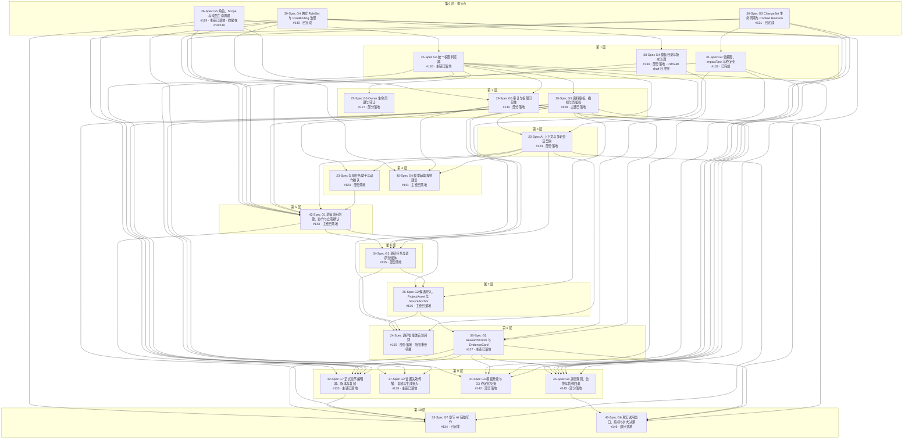

# G1–G7 Spec 完成路径图

## 口径

- **基线**：依赖图与落地判定最初基于 `origin/main` = `8bb1981`（2026-10-21 下午）。**已按 `origin/main` = `912fb901` 复核**（main 又前移 81 个提交，PR#293 Spec #47 段二与 PR#323 G3 缺口收口 r3 已合入）。复核结论：66 条原生依赖边不变；登记处声明的既有路径全部仍在 main 上；**#139 的档位由「未开工」修正为「部分落地」**——main 上已有 `internal/lingdoc/templategovernance/catalog.go`（Profile 管理）与 `workspacecore.TemplateCatalogResolver` 端口，完整的目录与版本治理在未合并的 PR#248 里。**依赖边的重算与路径图的重新生成需要在 `main` 再次前移后进行。**
- **依赖真相源**：GitHub 原生 `blocked_by` 关系（`GET /repos/magician336/lingdoc/issues/{n}/dependencies/blocked_by`）。本图**不**以 issue 正文或 Spec 文档的依赖描述作为依赖真相；文档声明与原生关系的差异已于 2026-10-21 统一，补边记录见文末。
- **落地判定**：代码入口 + HTTP 路由 + 迁移 + 前端消费四要素在 `main` 上齐备 = 「主链已落地」。**主链已落地 ≠ 验收通过**：它只说明该 Spec 的能力有一条可运行的路径，不说明其全部验收点成立。
- **未运行声明**：本图的落地判定是**静态存在性核对**（grep / 文件树 / 路由注册 / 迁移文件），**未运行 `go test` / `npm test`，未启动服务做端到端验证**。标注为「部分落地」的缺口是「grep 无命中」或「推断」，需定向测试确认。
- **节点**：Spec 文档（`docs/06-灵档产品开发规划/NN-Spec-*.md`）。issue 是 Spec 的发布副本兼执行票，用于状态判定，不作为独立节点。
- **分层算法**：最长路径分层，层号 = 1 + max(所有 blocker 的层号)。已关闭的 blocker 同样计入拓扑（它们在 L0/L1）。

## 权威依赖表

23 张 Spec，共 66 条原生依赖边。

| Spec | issue | 票状态 | 原生 blocker | 落地档位 | 在飞 PR |
|---|---|---|---|---|---|
| 26-Spec G5 角色、Scope 与成员生命周期 | #129 | open | — | 主链已落地·收尾在飞 | PR#149 |
| 30-Spec G3 ChangeSet 生命周期与 Context Revision | #131 | closed | — | 已完成 | — |
| 39-Spec G4 独立 RuleSet 与 RuleBinding 治理 | #140 | closed | — | 已完成 | — |
| 25-Spec G5 统一权限判定器 | #126 | open | #129 | 主链已落地 | — |
| 31-Spec G3 依赖图、ImpactTask 与稳定化 | #132 | closed | #131 | 已完成 | — |
| 38-Spec G4 模板目录与版本治理 | #139 | open | #140 | 部分落地 | PR#248（draft，**已与 main 冲突**） |
| 27-Spec G5 Owner 生命周期与转让 | #127 | open | #126 | 部分落地 | — |
| 28-Spec G5 资料授权、撤权与再鉴权 | #128 | open | #126 | 主链已落地 | — |
| 29-Spec G5 审计与权限可见性 | #130 | open | #126, #129 | 部分落地 | — |
| 22-Spec AI 上下文与多轮会话契约 | #124 | open | #126, #128 | 部分落地 | — |
| 23-Spec 当前任务助手与动作确认 | #123 | open | #124, #130 | 部分落地 | — |
| 40-Spec G4 模型辅助规则建议 | #141 | open | #124, #130, #140 | 主链已落地 | — |
| 42-Spec G1 草稿项目创建、协作与立项确认 | #143 | open | #123, #124, #126, #127, #129, #131, #139, #140 | 主链已落地 | — |
| 34-Spec G2 调研任务与调研智能体 | #135 | open | #124, #126, #128, #143 | 部分落地 | — |
| 35-Spec G2 候选导入、ProjectAsset 与 SourceAnchor | #136 | open | #128, #135, #143 | 主链已落地 | — |
| 24-Spec 调研智能体首轮闭环 | #125 | open | #124, #128, #135, #136 | 部分落地 | — |
| 36-Spec G2 ResearchClaim 与 EvidenceCard | #137 | open | #128, #132, #136 | 主链已落地 | — |
| 32-Spec G7 正式章节编辑器、版本与复核 | #133 | open | #126, #128, #129, #131, #137, #143 | 主链已落地 | — |
| 37-Spec G2 证据失效传播、复核与生成接入 | #138 | open | #128, #132, #137 | 主链已落地 | — |
| 41-Spec G4 模板升级与 G3 稳定化交接 | #142 | open | #131, #132, #137, #139, #140 | 部分落地 | — |
| 45-Spec G6 运行观测、告警与暂停回退 | #145 | open | #126, #128, #130, #131, #132, #137, #140 | 部分落地 | — |
| 33-Spec G7 章节 AI 辅助写作 | #134 | closed | #124, #128, #133, #137, #140 | 已完成 | — |
| 46-Spec G6 真实试用窗口、指标与扩大决策 | #146 | open | #128, #137, #140, #145 | 部分落地 | — |

## 分层路径图

箭头 = 原生 `blocked_by` 方向（先做 → 后做）。层号 = 最长路径分层，层号越大越晚。



## 关键路径

最长链 **10 跳、11 层**，**穿过两张原生「看起来不是根」的 Spec**：

```
#129 → #126 → #128 → #124 → #123 → #143 → #135 → #136 → #137 → #133 → #134
```

- `#128`（资料授权、撤权与再鉴权）在原生关系里只有一条 blocker（#126），看起来像次要节点；它实际上有 **10 条出边**，是第二道总闸门。
- `#133`（G7 正式章节编辑器）同时被 #143（G1 立项）与 #137（G2 主张与证据卡）挡住，而这两张在补边前的原生图里与它毫无关系。
- 第二条同样长的链：`#139 → #143 → #135 → #136 → #137 → #133 → #134`。

## 依赖边的语义分档

**依赖边 ≠ 施工顺序。** 这条必须先说清楚，否则 11 层 66 条边会被读成「只能一条线走」。

判据：**下游写代码时，是否必须知道上游的「具体行为」（状态取值、失败模式、接口语义），而不只是上游的「契约」。**

| 档 | 含义 | 边数 | 实例 |
|---|---|---|---|
| **① 接口未冻结** | 下游连契约都没有，必须等上游设计 | **0** | 所有相关 Spec 文档都已写明契约 |
| **② 行为未稳定** | 契约有，但上游行为未定义或还会变，下游写了要返工 | **1** | #127 → #143 |
| **③ 验收未满足** | 上游行为已定，下游可独立实现，只是最终验收要等上游端到端链路 | **64** | 其余全部 |
| ② 待定 | 取决于上游剩余工作是「补缺口」还是「改行为」 | **1** | #135 → #125 |

**② 档唯一那条**：`owner_unavailable` 状态串全仓不存在，上游行为不是「未稳定」而是**未定义**。下游写不出「Owner 不可用时不能立项」这个分支。

**② 待定那条**：#135 → #125。#135 的调研任务模型已落地，但剩余工作含**新增** research purpose——如果它改写现有调研任务的行为，#125 就要跟着改；如果是纯新增，#125 不受影响。待 PF-5 落地后确认。

### 为什么边不能直接当施工顺序：三条证据

1. **#143（G1 立项）主链已落地，而它的 blocker #139（G4 模板目录）在 `main` 上完全没有落点。** 若边=施工顺序，这个事实不可能出现。
2. **8 张 Spec 主链已在 `main`，而它们的 blocker 全部还开着**（#126 #128 #133 #136 #137 #138 #141 #143）。
3. **24-Spec 与 34-Spec 各自都自称「第一条切片」**，34/35/36/37-Spec 本身就被设计成四片。

结论：**③ 档的解锁条件不是「上游写完」，而是「契约冻结」。** 这正是 Ousterhout 说的「先写接口」——先把拥有真相的模块的契约与不变量定下来，下游就能对着契约开工。

## 当前 frontier

| 票 | Spec | 状态 |
|---|---|---|
| #129 | 26-Spec G5 角色、Scope 与成员生命周期 | open，无 open blocker，**已被 lzmp666 认领**，PR#149 在飞 |
| #139 | 38-Spec G4 模板目录与版本治理 | open，无 open blocker，**已被 lzmp666 认领**，PR#248 在飞（draft） |

按 wayfinder 的 frontier 定义（open + 无 open blocker + **未认领**），**G1–G7 线当前没有未认领的 frontier 票**。

两张在飞 PR：

| PR | head | 票 | checks | mergeable | 备注 |
|---|---|---|---|---|---|
| #149 | `cdac79d` | #129 | 全绿 | **DIRTY（与 main 冲突）** | main 已前移 81 个提交，它未并基线；36 文件 +1605/-90；main 上是 #129 的早期不完整版本 |
| #248 | `f9c96bf` | #139 | 全绿 | **DIRTY（与 main 冲突）** | draft；已有 2 次 CHANGES_REQUESTED；main 已前移 81 个提交，它未并基线 |

## 状态词表

单一四档装不下真实情况，状态按 **票状态 × 代码证据** 两个维度合成：

| 档位 | 票 | 代码 | 本图实例 |
|---|---|---|---|
| **已完成** | closed | 在 main | #131 #132 #140 #134 |
| **主链已落地·收尾在飞** | open | 主链在 main，收尾在未合并 PR | #129 |
| **主链已落地** | open | 四要素齐备 | #126 #128 #133 #136 #137 #138 #141 #143 |
| **部分落地** | open | 部分验收点缺 | #123 #124 #125 #127 #130 #135 #142 #145 #146 |
| **未开工** | open | main 无对应落点 | 本图无实例（保留为守护档） |
| **已关未落地** | closed | **不在 main** | 本图无实例（见下） |

**「已关未落地」在本图内没有实例，但它是真实发生过的异常**：Spec #47 线上的 #262（47.06 错误形态跨面归并）、#271（47.03 章节「已确认」单一谓词）、#263（47.07 旧错误平表 contract）三张票在 2026-10-20 12:16–12:17 被手动关闭，但当时 `workspacecore.ChapterConfirmed`、`internal/clienterror/catalog.go` 与 47.07 的守护测试在 `main` 上均不存在，代码只锁在未合并的 PR#293 里。

> **该状态已于 2026-10-21 21:00 前后解除**：PR#293 合入 `main`（`633ba347`），上述三个产物现在都在 `main` 上（`internal/lingdoc/workspacecore/chapter_confirmation.go`、`internal/clienterror/catalog.go`、`internal/lingdoc/workspace/client_form_convergence_test.go`）。**保留该档位作为守护样本**——它证明「票关了但代码没进 main」是真实会发生的，而不是理论风险。

## 施工并行面

依赖图回答「顺序对不对」，**并行面回答「今天开什么」**。两者的登记处不同：

- **依赖图**（本文件 + 原生 `blocked_by`）= 顺序与验收依赖，快照性质。
- **施工并行面登记处** = [`scripts/lingdoc_parallel_surfaces.py`](https://github.com/magician336/lingdoc/blob/main/scripts/lingdoc_parallel_surfaces.py) = **活的状态与文件所有权**，按门禁面清单的同款形态维护（declarative + loader 校验 + 守护测试）。它放在 `scripts/` 而不是 `scripts/ci/`，因为 `scripts/ci/` 是门禁判定层，必须保持「只有一个模块回答『什么会跑』」；登记处回答的是另一个问题——「谁可以碰哪些路径」。

### 为什么要有登记处

两个面碰同一个文件，并行就会互相覆盖；而这种撞车在合并前看不出来。登记处把**文件所有权**变成可执行约束：任何两个面的路径集重叠，登记处直接拒绝加载并以非零退出，守护测试 `scripts/ci/test_lingdoc_parallel_surfaces.py` 守住这条不变量（随 `lingdoc-review.yml` 的 `test_lingdoc_*.py` 自动进 CI）。

### 当前的七个面

每个面在 tracker 上有一张自己的票（**票是执行单元，Spec 是交付单元**），票已挂成对应 Spec 票的 GitHub 子票。

| 票 | 面 | 交付（Spec） | 文件所有权 | 零阻塞理由 |
|---|---|---|---|---|
| [#325](https://github.com/magician336/lingdoc/issues/325) | **PF-1** G6 运维与试用前端 | #145 #146 | **路径集以登记处为准**（本面已于 2026-10-22 交付运行指标视图与前端契约保护，2026-10-23 G6 前端独立化时把 `ImpactOpsPanel.vue`、`mainlineChanges.test.js`、`ImpactOpsPanel.test.js` 与口径表 `runtimeMetrics.ts` / `runtimeMetrics.test.ts` 交给 PF-7；本面已交面，只保留自己的方案档 `docs/08-本轮实施方案/G6-运维前端-指标视图与契约-20261022.md`） | **已于 2026-10-22 完成**：把服务端 `RuntimeMetrics.counts` 投影成可读的指标视图，并给 G6 前端补契约保护。前端独立化与 Workspace 集成由 PF-7（#384）承接 |
| [#326](https://github.com/magician336/lingdoc/issues/326) | **PF-2** G7 AI 动作族 | #134 | **路径集以登记处为准**（本面 2026-10-22 补齐到 **56** 条：新增 `internal/lingdoc/writingaction/`、`internal/lingdoc/candidateadoption/`、`internal/lingdoc/generation/`，`internal/lingdoc/workspace/` 下的选段改写与评审执行方，`internal/clienterror/catalog.go`、`internal/router/lingdoc_routes_test.go`，前端动作面板 / 评审报告面板 / 动作表客户端等） | **已于 2026-10-22 完成**：十四张施工票 + 集成步已随 PR #357 合入 `main`（合并提交 `c4c9ac93`），Spec #134 随之关闭；残留票 #385 / #386 保持开放 |
| [#327](https://github.com/magician336/lingdoc/issues/327) | **PF-3** 审计告警接线与 AuditEvent 字段 | #130 | **路径集以登记处为准**（本面 2026-10-23 一次交付 #382 / #327 / #383 三张后端票，扩到 19 条：`workspacecore/runtime_control.go`、`runtime_alert_rule.go`、`runtime_observation.go` 与三个测试、`permission_policy.go`、`service_facade.go`、`service.go`、`model.go`、`typed_contracts.go`、`context_ports.go` + 测试、`operation_pipeline.go`、`workspace/impact_routes.go`、`operationcore/operationcore.go`、`container/lingdoc.go`、`contracts/openapi.json` 与本面方案档） | **2026-10-23 已认领并实现**：告警规则可读回与可停用、授权拒绝落成 `permission/deny` 运行事件、审计写失败落成 `audit/failed` 并接告警规则、`AuditEvent` 两字段走 `details_json`（零迁移）、运行控制新增 `rollback`（经既有 `reverseChangeSet` 领域入口）。三张票的票面见 #382 / #383 |
| [#328](https://github.com/magician336/lingdoc/issues/328) | **PF-4** `owner_unavailable` 状态与 Owner-only 冻结 | #127 | **路径集以登记处为准**（本面 2026-10-22 补齐到 **17** 条：判定与冻结出口 `workspacecore/member_lifecycle_state.go`（新增）、`member_judgement.go`、`owner_transfer_proof.go`、`delivery_export_guard.go`、`service_facade.go`、`typed_contracts.go`、`membership.go`，转让与权限出口 `membership/results.go`、`membership/policy.go`，契约与路由 `router/routes_lingdoc.go`、`contracts/openapi.json`，前端 `api/lingdoc/permissions.ts` 与新建的 `composables/useOwnerAvailability.ts`、`views/lingdoc/OwnerUnavailableNotice.vue`） | **2026-10-22 已认领**（登记处 `status=claimed`、认领人 magician336；票 #328 指派同一人）。实现契约见 Spec [#391](https://github.com/magician336/lingdoc/issues/391)（仓内副本 `docs/06-灵档产品开发规划/49-Spec-owner_unavailable派生状态与Owner-only冻结.md`）。修完即解除 ② 档那条实现依赖（#127 → #143） |
| [#329](https://github.com/magician336/lingdoc/issues/329) | **PF-5** Agent research purpose | #135 #125 | `internal/lingdoc/workspace/agent_model.go`、`internal/lingdoc/workspacecore/agent_action_service.go`、`agent_research_model.go` | 上下文包后端已在 `agent_research_model.go` 落地，不必等 #124 的前端消费 |
| [#330](https://github.com/magician336/lingdoc/issues/330) | **PF-6** 上下文包前端消费 | #124 | `frontend/src/api/lingdoc/g2Context.ts`、`frontend/src/views/lingdoc/ContextPackagePanel.vue`（均新增） | 后端契约已定，前端零消费 |
| [#384](https://github.com/magician336/lingdoc/issues/384) | **PF-7** G6 运维面板独立化与 Workspace 集成 | #145 #146 | **路径集以登记处为准**（本面 2026-10-23 从 PF-1 接手 `ImpactOpsPanel.vue`、`mainlineChanges.test.js`、`ImpactOpsPanel.test.js`、口径表 `runtimeMetrics.ts` / `runtimeMetrics.test.ts`，并认领 PF-1 留下的无主路径 `mainlineChanges.ts`；新建 `api/lingdoc/runtimeControl.ts` + 测试、`trialWindow.ts` + 测试、`views/lingdoc/RuntimeOpsPanel.vue` + 测试） | **2026-10-23 已认领并实现**：把 G6 前端从 G3 面板里拆出来，并在 Workspace 抽屉里给它自己的入口位（`FullPanel` 新增 `'operations'`）。**保留路径** `Workspace.vue` 由维护者显式授权本轮改动，任何面都不得声明它 |

七张票都标 `ready-for-agent`。**#326（PF-2）与 #325（PF-1）已被 magician336 认领并完成**（登记处 `status` 均为 `done`；完成态不保留 `claimed_by`，认领与完成的人记在 `summary` 里）：PF-1 于 2026-10-22 完成，**PF-2 同日完成**——十四张施工票 + 集成步已随 PR #357 合入 `main`（合并提交 `c4c9ac93`），Spec #134 随之关闭，#326 及下面 17 张票全部关闭。两张残留票保持开放：[#385](https://github.com/magician336/lingdoc/issues/385)（动作表按目标范围给动作、执行按管道分）、[#386](https://github.com/magician336/lingdoc/issues/386)（两处手抄迁移子集夹具）。**#328（PF-4）也已被 magician336 认领**（登记处 `status=claimed`，认领人填 `claimed_by`；票 #328 同一人指派，两处同步）。**#329（PF-5）同样已被认领**（登记处 `status=claimed`；PR #390 合入 main）。**#327（PF-3）与 #384（PF-7）于 2026-10-23 由 magician336 认领**（登记处 `status` 均为 `claimed`；PF-3 一次交付 #382 / #327 / #383 三张后端票，PF-7 交付 #384 的前端独立化）。其余一张（PF-6）在登记处仍是 `available`，未被认领——**认领状态以登记处为准**。

> **PF-7 的路径集有两处需要读者知道**：一是 `mainlineChanges.ts`——PF-1 留下的「无主路径」缺口，由本面认领（G6 客户端从这里搬出去，文件本身留下 G3 的变更集与影响任务）；二是 PF-1 名下的 `ImpactOpsPanel.vue`、`mainlineChanges.test.js`、`ImpactOpsPanel.test.js` 与口径表 `runtimeMetrics.ts` / `runtimeMetrics.test.ts`，本面也要改（把 G6 段搬走、口径表接上后端补的 `permission/deny` 观测），而登记处不允许两面包同一路径。**2026-10-23 经维护者裁决，这五个路径已由 PF-1 转移到 PF-7**（PF-1 已交面，只保留自己的方案档）；转移前的状态记在登记处 PF-1 的 `summary` 里。
>
> **PF-1 的路径集在 2026-10-22 改过**：初次登记时列的是三个**新建**文件（`g6Runtime.ts` / `g6Trial.ts` / `G6OpsPanel.vue`），前提是「G6 前端为零」。施工时核实发现该前提已过时——16 个 G6 端点客户端与两个 tab 的界面早已在 main 上，重复新建会造成两套并行实现。于是本面缩为「补真实缺口」：把服务端 `RuntimeMetrics.counts` 投影成可读的指标视图，并给 G6 前端补契约保护。**G6 前端的独立化与 Workspace 集成不在本面**，另开 [#384](https://github.com/magician336/lingdoc/issues/384)。路径集与边界以登记处 `scripts/lingdoc_parallel_surfaces.py` 为准，本表只是它的说明副本。

**PF-2 的路径集是按票面实测补齐的**：初次登记时只列了 6 个文件，#326 认领后实测发现它还要改 `candidateadoption/*`、`generation/store.go`、`workspace/http.go`、`workspacecore/human_decision.go`、`clienterror/catalog.go`、`router/lingdoc_routes_test.go` —— 这些**不被任何面拥有**，即两个面会碰同一文件的撞车风险。补齐后与其余五面仍然零重叠（PF-3 独占 `workspacecore/model.go`、PF-5 独占 `workspacecore/g2_*.go`，都没冲突）。

> 这条记录本身就是登记处存在的理由：**如果只有票面文字、没有机器可校验的登记处，这次的路径集缺口不会被发现**。

**保留路径**：`frontend/src/views/lingdoc/Workspace.vue` 归集成点所有，**任何面都不得声明**——所有前端面在最后单独做一次集成，不由谁独占。

**两处已知的归属约定**：

- PF-7 与 PF-6 同属前端目录 → **不得改对方文件**。PF-7 认领了 PF-1 交来的既有文件并新建 `runtimeControl.ts` / `trialWindow.ts` / `RuntimeOpsPanel.vue`；PF-6 仍只新增 `g2Context.ts` 与 `ContextPackagePanel.vue`；两面的路径集零重叠。
- PF-3 与 PF-4 都需要 workspacecore 里的类型 → PF-3 独占 `model.go`（AuditEvent 是既有 struct，加字段必须改原处），PF-4 把 `owner_unavailable` 状态串放**独立新文件**，避开 `model.go`。PF-4 的 `owner_unavailable` 是**读时派生**的事实，不进领域 `Project` 结构体，也不落库。
- **PF-3 与 PF-4 的路径重叠已由维护者裁决**：2026-10-23 PF-3 先走，`service_facade.go`、`typed_contracts.go`、`contracts/openapi.json` 由 PF-4 让给 PF-3，待 PF-3 合入 main 后归还；届时两边改动点都在授权判定附近，需人工解一次冲突。
- **PF-4 的前端有两处是集成步骤而不是面拥有**：`frontend/src/views/lingdoc/Workspace.vue` 是所有前端面的集成点（保留路径，任一面都不得独占），`frontend/src/views/lingdoc/ImpactOpsPanel.vue` 属 PF-7（PF-1 已交面时转来）。这两处的改动在 PR 里显式标注，不记成面拥有。

### 怎么领面

1. 在 tracker 上认领该面的票（`gh issue edit <票号> --add-assignee @me`）——**票是认领的原语**。
2. 在登记处把该面的 `status` 改成 `claimed` 并填 `claimed_by`（`claimed` 必须有认领人，`available` 必须没有——两条都由校验强制；登记处与票任一不同步都算坏状态）。
3. 跑 `python scripts/lingdoc_parallel_surfaces.py` 自检，非零退出即登记处坏了。
4. 完成后把 `status` 改成 `done`（**完成态不保留 `claimed_by`**——登记处只允许 `claimed` 状态带认领人，校验会拒绝其它状态带认领人；认领与完成的人记在 `summary` 里）。

## 四个缺口簇

缺口不是散的，收敛成四簇。每簇有独立的代码入口与验证方式。

### ① Owner 不可用（`owner_unavailable` 状态不存在）

`owner_unavailable` 状态串**全仓 grep 0 命中**。27-Spec 的「租户身份失效 → 冻结 Owner-only 动作 → 租户恢复后自动解冻」这条链，目前只能用「再提名一次」代替；冻结原因也没有专门错误码，只落通用 `ErrInvalidState`。

**卡住**：#127 → #143（42-Spec US-34「Owner 不可用时不能立项」）→ **卡 G1 整条**。

### ② 审计失败不告警

29-Spec 的 fail-open 语义已实现（普通读审计失败继续读并记录），但**没有接到告警**：`runtime_control.go` 的告警源里没有审计事件。`AuditEvent` 也没有 `target_version` / `project_revision` 字段。

**卡住**：#130 → #145（29-Spec 自述「the observability boundary consumed by G6」）→ **卡 G6 整条**。

### ③ Agent 缺 research 用途

`internal/lingdoc/workspace/agent_model.go` 只有 `rule_suggestion` 与 `change_draft` 两种 purpose，没有 research 用途。因此「Agent 推荐查询词与来源并解释理由与缺口」在产品层是空的。

**卡住**：#124 #125 #135 → **卡 G2 整条**。

### ④ 前端与动作族

- **G6 前端已独立成面板（PF-7，#384，2026-10-23 施工中）**：16 个 G6 端点客户端与运行/试用两个 tab 原本寄生在 G3 面板里（`api/lingdoc/mainlineChanges.ts:112-127`、`ImpactOpsPanel.vue:55-83`），值班人员要先进入「变更与运行质量」再切 tab。PF-1（#325）于 2026-10-22 补上运行指标视图与前端契约保护；**独立化与 Workspace 集成由 PF-7 承接**：客户端搬到 `api/lingdoc/runtimeControl.ts` 与 `api/lingdoc/trialWindow.ts`，界面搬到 `views/lingdoc/RuntimeOpsPanel.vue`，Workspace 抽屉里给它自己的入口位（「运行观测与试用」）。后端不动，行为不变。
- **#134 动作族已落地**（PF-2，2026-10-22 完成）：八类动作（提纲 / 生成 / 续写 / 改写 / 压缩 / 扩展 / 转写 / 语言评审）由 `internal/lingdoc/writingaction` **独占拥有**，产出参数是闭合取值集，采纳必须带**显式确认载荷**（动作 × 采纳目标 × 目标范围 × 确认时刻 × 确认人 × 来源，六项缺一在服务层被拒），「人工 / AI 生成 / AI 辅助」来源标注随候选走。**未裁决的遗留**：续写是「替换选区」还是「插入其后」（#342）、提纲是「替换整篇工作副本」还是「与已有正文并存」（#347）——两者都要词汇包先声明「插入 vs 替换」语义。

### 缺口簇与施工并行面的对应

| 缺口簇 | 落在哪个面 |
|---|---|
| ① Owner 不可用 | **PF-4** |
| ② 审计失败不告警 | **PF-3** |
| ③ Agent 缺 research 用途 | **PF-5**（后端）+ **PF-6**（上下文包前端消费） |
| ④ 前端与动作族 | **PF-7**（G6 前端独立化与 Workspace 集成）+ **PF-2**（#134 动作族） |

四个簇与六个面是一一覆盖的，且六个面的文件集互不重叠——**这四簇缺口可以同时开，不需要排队。**

## 原生关系补边记录

2026-10-21 之前，Spec 文档声明了 19 条依赖，但原生 `blocked_by` 图里一条都没有——原生图只是实现顺序的一个近似，不是完整真相。已按文档证据补齐 **23 条**边（其中 4 条 blocker 已关闭，不影响当前 frontier，只补全历史可读性），补边后 Spec 层共 66 条边、最大层深 10。

补边依据（逐条）：

| 边 | 依据 |
|---|---|
| #128 → #124 #125 #133 #134 #135 #136 #137 #138 #145 #146 | 28-Spec Further Notes：「resource boundary for G2, the context package for AI Specs, and the download gate for G6/G7」；24-Spec Impl：「Revocation removes restricted content from later Agent context」 |
| #130 → #123 | 23-Spec US-18：「every proposal, confirmation, execution … traceable」 |
| #130 → #141 | 40-Spec Impl：「G5 上下文与审计边界」 |
| #130 → #145 | 29-Spec Further Notes：「the observability boundary consumed by G6」 |
| #127 → #143 | 42-Spec US-34：「Owner 不可用时不能立项」 |
| #139 → #143 | 38-Spec Impl「发布前规则绑定校验」；42-Spec Impl「立项闸门调用 G4 共享规则求值器」 |
| #137 → #133 | 32-Spec US-13：「EvidenceCard/ResearchClaim links preserved when I save」 |
| #143 → #133 | G7 计划 §15：「只消费 active 项目和立项生成的章节骨架」 |
| #140 → #134 | 33-Spec Further Notes：「G4 rule evaluation」 |
| #140 → #143 | 42-Spec Impl：「立项闸门调用 G4 共享规则求值器」 |
| #140 → #145 | 45-Spec Further Notes：「G4 Preflight 语义」 |
| #140 → #146 | 46-Spec 引言：「G1–G5 的质量证据」 |
| #131 → #143 | 30-Spec Impl / G3 计划 §14：「G1 activation from revision 0 to 1」 |
| #132 → #137 | 31-Spec Impl：「DependencyEdge 目标含 EvidenceCard, ResearchClaim」 |

**未补的边**：#140 → #138（37-Spec 只说「复用现有 …Delivery/Preflight seam」，属复用既有实现而非依赖，不构成阻塞边）。

**补边的副作用**：#129 与 #139 仍是根节点（它们是出边源，不是入边目标），当前 frontier 未变；但 #143 #133 #134 #145 #146 等下游 Spec 的层号后移，「G7 编辑器依赖 G1 立项」这一事实现在在图上可见。

## 已知矛盾与待裁决

1. **#125 与 #135 范围重叠**：24-Spec 自称「the first implementation slice for the complete research agent」，34-Spec 自称「完整 G2 的第一条开发切片」，两者都 open，原生边已断言「先 #135 后 #125」。文档未写二者关系，本图按重叠标注，不做裁剪。
2. **22-Spec 与 32/33-Spec 的先后**：22-Spec Implementation Decisions 写「G7 context-package semantics are the prior art」，其中「prior art」与 `GenerationContext`、`SourcePolicy`、`Candidate/Chapter version basis` 并列，指**既有实现可复用的部分**，不是「22 依赖 G7」。33-Spec Further Notes 明写「depends on the shared AI context … Specs」，与原生边 #124 → #133 一致。两处不矛盾。
3. **43-Spec / 44-Spec 不存在**：G1–G7 的 Spec 编号有跳号。

## Out of scope

- **Spec #47 模块边界收口线**（#259，切片 #264–#276）：横切 G2/G3/G5 的用例边界，与本图并行推进，不在本图的依赖链内。其子票 #273（47.08 共享核心）是其自身的根。
- **G3 缺口清单 #246** 及其解除条件票（#306 #310 #314 #315）：验收台口径，不在本图的依赖链内。
- **#187 / #193**（RuleSet binding 证据与双库并发验收闭环）：验收闭环，不在开发依赖链内。
- **#116**（C 工作台与正式入口合流方式，`wayfinder:prototype`）：属 #112 的 frontier，不是 Spec 依赖链的一环。
