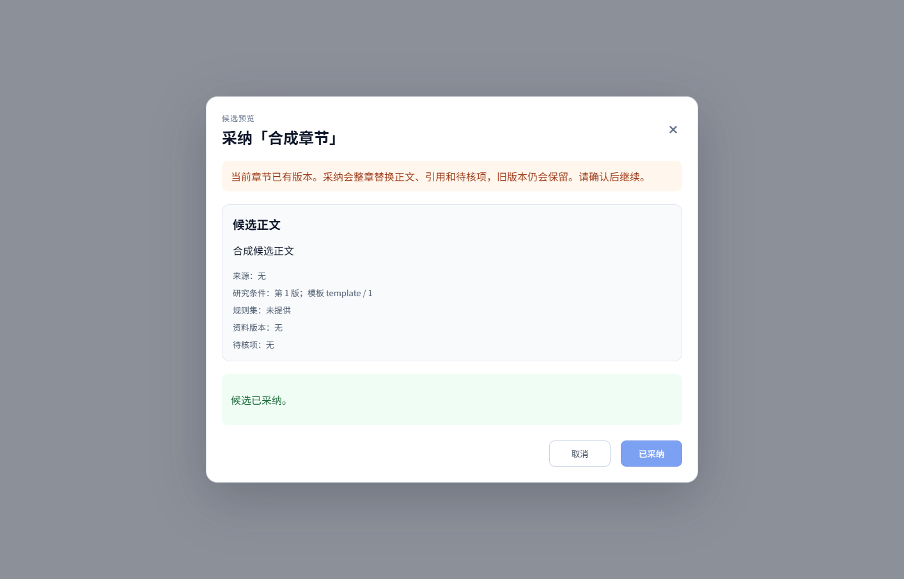

# 工作台 UI 状态小补丁：评审与验收

## 范围与基线

独立分支 `codex/ui-state-safety-20261011`，基于 main `064abbc005215f063d6ca8ec69d874ebc8ceb228`。不包含尚未合并的 #105/#106，不修改既有脏工作树、HTTP DTO、数据库或权限规则。

1. **防误离开**：900ms 自动保存尚未触发、保存中或保存失败，刷新/关页有浏览器警告；离开工作台有确认。正文、引用用途、研究条件、模板草稿、未确认待核理由都计入；已经保存的工作副本可正常离开。服务器确认理由后记录表单基线，保留理由但解除误报。组件卸载移除监听。
2. **确认原因可见**：按钮旁显示缺少的理由数量及保存/提交条件，屏幕阅读器能关联说明。显示与实际调用共享判断，不用 tooltip 隐藏关键步骤。
3. **承认写入成功，独立处理读回失败**：采纳成功后禁止重复采纳；读回失败显示“已采纳”，只提供重新读取入口。读回中取消关闭禁用；成功读回才交给父级更新。父级刷新失败继续明确采纳已成功。交付 409 先显示刷新中，父级实际成功/失败回告后再更新文案，不自动重试检查或导出。

状态清单见 [UI状态清单-20261011.md](UI状态清单-20261011.md)，已修正任务持久化、修复提示推断和过早宣称刷新成功的判断。

原建议的前两项已实现；第三项“服务端静默修复提示”经复核改为待确认：现有接口没有明确 repaired 标记，revision 跳变可能来自另一窗口保存，不能据此猜测并展示“已修复”。本轮纠正这项判断，不修改 #106 后端合同。另补已确认的采纳读回和交付刷新反馈缺口，避免成功动作被误报为失败。

## 复跑

使用现有锁定依赖；本轮离线复用已有 node_modules，无新依赖或依赖下载。

```sh
cd frontend
npm test
npm run type-check
npm test -- src/views/lingdoc/uiSafety.test.ts src/views/lingdoc/candidateAdoption.test.ts src/views/lingdoc/deliveryState.test.ts
```

浏览器合成验证是可选本机检查，实际编译并挂载产品 SFC，API 替换为明确合成服务；用独立 Edge profile 与临时 loopback 端口，测试结束关闭自身浏览器与服务。不连接原产品后台，不读密钥、不产生模型费用。

```powershell
cd frontend
$env:UI_SAFETY_EVIDENCE = 'D:/Mon3tr/projects/lingdoc-dachuang/acceptance/ui-state-safety-20261011/browser'
# 如未使用默认 Windows Edge，可显式指定 Chromium 浏览器可执行路径：
# $env:UI_SAFETY_BROWSER = 'C:/Program Files/Google/Chrome/Application/chrome.exe'
node tests/ui-safety.browser.mjs
```

本次结果：全量 953 PASS、3 SKIPPED、0 FAIL；类型检查 PASS；定向 15/15；浏览器 19/19，runtime exception=0。浏览器机器结果含产品 SFC 源文件 SHA-256；本机截图与失败尝试保存在仓外验收目录，纯合成截图另在本目录图片中供评审查看。



## 协作者操作

- 在合成项目中快速输入正文，900ms 内刷新；取消离开，应看到原输入。保存中或故意断开后端导致保存失败时重复验证。正常保存后离开应不误报。
- 填写待核理由但未确认，离开应提醒；确认成功后仅保留表单不应继续提醒。修改研究条件、引用用途和模板草稿也应提醒。
- 未填理由时确认按钮旁显示数量；逐条填写后解除该理由阻断。工作副本尚未提交时显示提交要求。保护条件保持服务端规则。
- 用测试代理/合成服务使采纳 POST 成功、随后 GET 失败：显示已采纳、采纳按钮禁用；多次“重新读取章节状态”只能发 GET，不得再发 POST；读回恢复后显示服务器当前版本。
- 交付遇版本冲突后延迟父级读取，先显示刷新中；读取失败不能显示成功；读取恢复后才能提示重试。原动作由用户明确重试。

## 限制与回退

beforeunload 由浏览器决定是否/怎样显示，通常要求先有用户交互；不能保证浏览器崩溃、移动端强杀或关闭时网络保存。此补丁不建设离线草稿恢复、跨标签正文合并或全局任务通知。

本次未运行真实后台/模型/Word/生产 OAuth 或 PostgreSQL；合成浏览器检查不是完整产品验收。Go 源码未改，不重复后端全量回归；本地未运行大型全仓生产构建，构建检查由 PR CI 执行。跳过用例仍如实保留，不等于通过。

回退可撤销本补丁提交，不涉及清库、迁移或权限降级。PR 保持未合并，独立评审和用户验收分别进行。
