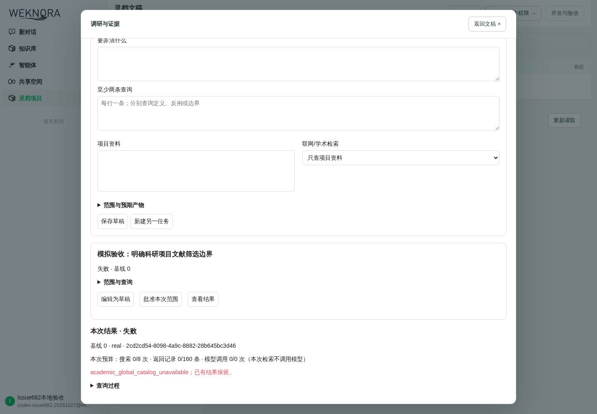

# Issue #682 / PR #755：CI 修复与本地补齐

> 最新补验：此前 66 条历史实跑已在提交 `50249c79` 逐项重跑全部 PASS，最终零跳过/失败。见 [66 项最新代码复验](Issue682-66项历史用例最新代码复验-20261027.md)；下文旧快照中的“66 条仅历史证据”保留为历史状态。

日期：2026-10-27。PR：[Draft #755](https://github.com/magician336/lingdoc/pull/755)，Issue #682 保持开放。

## 当前身份与结论

- 已同步 main 基线 `65ef7a030855185196743ca40e5d5bb3996698a1`；实际产品代码与本轮全部验证头 `6bfce6e405033a9a49de49cfc9b488e3213479f9`。后续证据文档提交不改变产品代码。
- 原失败已修：academic 包族登记遗漏、全范围固定夹具未同步，以及 main 上下文选择原因测试未确认卡片。保留生产确认门槛，只修夹具经过真实确认流程。
- 累计额度持久化实现、SQLite/PostgreSQL、实际 Research/Agent 应用消费者、HTTP、向量库占位测试均已补齐。正式策略数据仍缺；组合根安装真实账本，但 policy source 为 nil，目录也未批准，默认继续 fail-closed。
- GitHub 检查按最新提交单独记录；本地 PASS 不是 GitHub 工作流已完成的声明。PR 正文更新草稿先交子萌审核，没有直接改写 GitHub 正文。

## 处理位置与领域不变量

| 处理项 | 位置 | 行为 / 证据 |
| --- | --- | --- |
| CI academic 包族遗漏 | `scripts/ci/lingdoc_gate_decision.py` 及对应完整范围夹具 | 登记真实 main 包族，不删除守护；Linux 全套 982 项、1 项初始跳过；补足准确 main 引用后所在 49 项整组通过、无跳过。 |
| 未确认卡上下文夹具 | `workspacecore/agent_context_selection_reason_test.go` | 建立真实 claim、确认卡后构建上下文；原拒绝未确认卡测试仍在，十轮 race 通过。 |
| 累计额度归属 | `workspacecore/research_quota_ledger.go` | 复用现有项目事务、版本化对象、唯一哈希规则和原子审计；没有新表或平行工作流。 |
| 并发 / 权限 | `workspacecore/research_quota_storage.go` | 锁既有项目行后重读授权；Reserve/Settle 使用 Research、模型使用 Agent 授权；跨租户、撤权重试拒绝。 |
| 预留 / 结算 / 重启 | `research_quota_ledger_test.go`、`research_quota_postgres_test.go` | 搜索/结果上限保守预留；暂停保持占用；持久化终态才释放未用部分；未知/倒退使用量不退款。ID 幂等、不同输入冲突、明确不重叠窗口、失败模型调用计数、审计失败连历史版本回滚。 |
| 实际消费者 | `workspace/research_adapter.go`、`internal/container/lingdoc.go` | 真实账本经 adapter option 注入；HTTP 调研任务和研究 Agent 模型调用均走同一账本。没有批准策略时不自动给演示额度。 |
| 旧向量库占位 | `internal/application/service/vectorstore_test.go` | 真实 CreateStore / SQLite repository + 本地 ES 探测：不同 endpoint 同 index 允许，同 endpoint 重复拒绝，核对数据库行数。 |

## 当前提交验证

| 验证 | 结果与边界 |
| --- | --- |
| 根 Go 模块全包 `go test -json -count=1 -p=2 -timeout=30m ./...` | PASS：115 个测试包；12110 PASS、74 SKIP 事件（含子测试）；零失败。普通全包的 SKIP 不计为实跑。独立 cli/client 不属于此命令。 |
| SQLite / 真实 PostgreSQL 账本 `-race -count=10` | PASS：100 个通过事件、零跳过/失败。真实 PG 迁移、项目行锁、回滚、重开连接；策略与材料合成，非生产验收。 |
| main 新增 PG 模板升级验收 | PASS：`TestPostgresTemplateUpgradeTransactionReplayAndRestartReadBack`，race 实跑，含升级事务、重放和重开连接读回；不是普通全包 SKIP。 |
| 真实应用 / HTTP / 向量库消费者 | PASS：2 个定向测试；HTTP→ResearchAdapter→账本→SQLite；向量库服务→探测→repository。上游书目响应和额度策略为合成。 |
| CI scope 守护 | PASS：982 项初始 1 SKIP 是隔离副本缺 origin/main 引用；补足准确 main 基线后，该比较所在 49 项整组通过、无跳过。完整固定夹具同步。宿主 Windows 旧 Git 不支持 `git init -b` 的历史失败不隐去，等价 Linux 路径已通过。 |
| 增量 lint / 服务端构建 | PASS：CI 同版 golangci-lint 2.12.2；以 main 为基线生成 Go patch；实际带 SQLite FTS5 的服务端构建。 |
| 前端测试 / 带类型构建 | PASS；保留已有大 chunk 警告。 |
| 静态契约 | PASS：99 注册操作、72 前端调用；不冒充实时 HTTP 或实际导出验收。 |
| 当前前后端浏览器 / 后端重启 | PASS：当前后端对合成课题重新模拟批准并新建 Run；独立 Chromium 登录临时账号、打开该结果，缺目录零外部调用；重启真实服务端后 task/run 数据完全相同。计划编辑仍标为历史证据。 |

命令、摘要与原始日志哈希见 [本轮证据目录](evidence/issue682-pr755-followup-20261027/validation-commands.json)。Go 全包机器摘要分别列出 SKIP。74 条中：2 条为本轮新补的 PG 实跑、66 条已有首轮历史补跑证据（不计当前头实跑）、6 条外部模型/评分尚未运行，详见 [逐项补跑状态](evidence/issue682-pr755-followup-20261027/skip-followup-status.json)。初次中断的全包/lint、错路径契约命令和旧 Windows Git 失败都保留为历史，不覆盖成 PASS。

## 仍未完成及精确解除条件

1. **BLOCKED：正式全局白名单**。缺批准的期刊/会议目录、维护人、版本和生效规则。用户已选暂缺并保留阻断；开发不能代填。
2. **BLOCKED：正式累计额度配置 / 策略来源**。账本本身和生产组合注入已实现、实测；尚无批准的项目搜索数/结果数/模型调用数及窗口起止/重置规则，生产 policy source 仍为 nil。提供输入后接入批准的 policy source；不能把合成额度或当前任务上限作为生产规则。
3. **未完成：批准原文与稳定定位适配器、完整学术成功链**。Crossref 只给元数据，仍拒绝伪造 locator/正式卡片。需要获批原文访问来源、许可和定位方式，再跑搜索→证据卡→逐张确认→版本化上下文→写作引用；本轮无该能力与来源，不能称完整 Spec 通过。
4. **NOT RUN：真实研究者最终确认与科研试写**。模拟批准不代替业务确认，#682 不关闭，PR 不转 Ready。
5. **NOT RUN：六个全仓外部模型/评分可选测试**。缺有效 endpoint/具体模型/未打码凭证及可用额度；不使用聊天打码 Key。旧 vectorstore 显式 SKIP 已被真实服务/repository 用例取代。

历史 PG/DocReader/真实 BrowserSkill/Crossref smoke 见旧报告，分别绑定各自 SHA；不把历史独立服务补跑算成当前完整产品链。当前 PG 账本是本轮单独实测。没有生产数据库目标，真实生产迁移/回滚为 N/A；本轮不新增迁移，PG 使用既有真实迁移建库。

保持原 PR Draft，不合并、不部署、不请求最终验收。D 盘保留工具、缓存与日志；完成本轮验证后停止 Docker 以释放内存。
