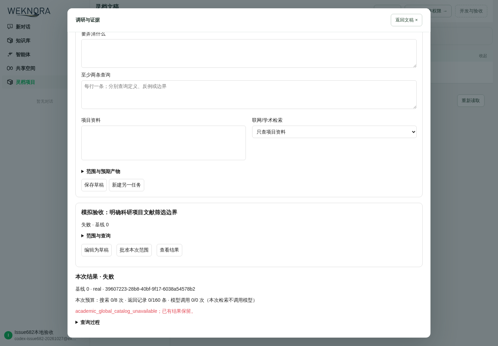

# Issue #682 本地复验与剩余边界

日期：2026-10-27。主 Issue：[受控学术调研与证据卡交接 #682](https://github.com/magician336/lingdoc/issues/682)。

本轮修复了本地 Go 验证的实际阻塞，并补跑数据库、服务适配器、浏览器与恢复场景。完整 Spec 仍未完成：正式全局学术目录、累计额度策略及生产账本、可提供原文定位的批准来源尚缺。生产继续 fail-closed，Issue 保持开放；PR 尚未创建，标题与正文先交子萌过目。

## 代码与证据身份

- 基线：`db45c9ff2f73e4b994d1ae7218ba872c779ad7c6`。
- 调研及 SQLite 修复验证头：`3b3459bc7fc958056d910b59746a9f10eb57d9c1`。
- 最终代码头：`6cce766b3b9c8ce9a3fbf8c4bf0c6fb26dd51056`；根模块全包、增量 lint、服务端构建均在该代码内容上实跑通过。后续仅提交验收文档。
- 后续独立修复：`8c69d073a4e778feaedf32054c957c929cb9982d`，仅改 `internal/browserskill/stop.go` 与对应测试。
- 前端、OpenAPI、数据库代码在后续修复中没有变化；Crossref 最后只做响应关闭返回值和等价结构转换的 lint 修订，已补定向/全包复验。浏览器/PG/前端证据来自前述被测面，BrowserSkill 新代码以独立真实守护程序 race 结果验证。不能将旧版本未运行的测试写成当前通过。
- 最终根模块全包机器摘要见 [go-final-head-summary.json](evidence/issue682-20261027/go-final-head-summary.json)；脱敏 HTTP 轨迹及逐项 SKIP 补跑状态在同一证据目录。原始日志保留在 D 盘工作区 `.tmp`，哈希见 [日志清单](evidence/issue682-20261027/raw-log-manifest.json)。账号密码、JWT、请求头、API Key 和本地 `.env` 不提交。

## 修复内容

1. **摘要规则归属**：学术目录曾自己实现 SHA-256 摘要，触发单一规则归属守护。改为复用 `operationcore.ValueHash`，保留原 JSON/摘要语义，不复制第二份规则。
2. **ChangeSet 并发测试**：接受合法的 `409, nil` 以及带 `ErrVersionConflict` 的冲突返回；SQLite 夹具使用与生产一致的单连接池，避免测试自行制造读写锁升级。仍断言恰好一个赢家、一次版本推进、仅赢家产生影响任务，不能吞掉其他错误。Windows 重复 50 次和 Linux race 重复 10 次通过。
3. **BrowserSkill 取消/停止**：真实官方 0.2.1 守护程序下，取消应答可能早于旧命令终态清理，停止请求因 `session already has an unfinished command` 被拒。只对这一明确的执行前拒绝做最多两秒、受调用上下文约束的重试；未知结果或执行后超时仍返回失败并保留暂停任务。原失败十轮可重复，修复后十轮 race 通过；补了未知结果不得重试的回归。
4. **增量 lint**：修正 Crossref 关闭响应的显式错误处理、测试写响应的错误检查，以及等价结构体转换；CI 同版本 `golangci-lint 2.12.2` 对本分支增量复验为 0 issues。保留宿主既有 nolint 注释格式警告。
5. **本地工具链**：使用 D 盘 Go 缓存和 UCRT GCC；补 Python venv/ensurepip、短临时路径和容器依赖。假 DNS 导致的公共地址解析问题仅在本轮隔离容器中修复，没有关闭产品 SSRF 检查或放宽生产白名单。

## 已执行验证

以下各层分别记录；普通全包 exit 0 不等于其中 SKIP 已实跑。

| 验证 | 命令或入口 | 结果与边界 |
| --- | --- | --- |
| 根 Go 模块全包 | `go test -json -count=1 -p 2 -timeout=30m ./...` | 最终头 `6cce766b`：114 个测试包通过，15 个包无测试；12065 个 PASS 事件（含子测试），71 个 SKIP，零失败。此前 `3b3459bc` 为 12062 PASS/73 SKIP；差异是新增一项回归及 DocReader 两项已能在全包中运行。`cli/`、`client/` 独立模块不在此命令范围。 |
| SQLite 并发 | Windows `-count=50`；Linux `-race -count=10`，均指定 `TestConcurrentApplyLetsOnlyOneChangeSetProduceImpactTasks` | PASS；验证单赢家、版本与任务归属。 |
| BrowserSkill 原生集成 | `BROWSERSKILL_TEST_BINARY=/tmp/bsk go test -race -json -count=10 -timeout=10m ./internal/browserskill` | PASS，670 个 PASS 事件，10 个 SKIP 是同一真实扩展测试的十次跳过，不能算十个不同缺项。守护程序来自官方锁定包并校验归档 SHA-256。 |
| 真实 BrowserSkill 扩展 | 独立 Chromium 140 / Playwright 1.55 / 官方守护程序 / Xvfb | PASS，`TestRealExtension` 31.48 秒；覆盖导航、快照、截图裁切、点击/输入、标签页、暂停/人工帮助、取消、窗口预览与结束。headless 预览曾超时，改用有显示的隔离环境后通过；不把合成网页 fixture 当真实科研验收。 |
| Go 增量 lint | `golangci-lint run --timeout=10m --concurrency=2 --new-from-patch=/artifacts/issue682-lint.patch` | PASS，锁定 v2.12.2，基线 db45c9ff，0 new issues。 |
| PostgreSQL 补跑 | 对初始跳过的 39 个顶层用例逐包选择实跑 | PASS，46 个 PASS 事件含子测试、11 个包、无跳过；隔离 PostgreSQL 17.9，故障库经真实迁移 0→137，覆盖迁移、并发、审计、冻结/导出、回滚与重启读回。不是生产数据库操作，也不是学术累计配额账本验收。 |
| Crossref 真实请求 | `LINGDOC_CROSSREF_LIVE=1 go test -v -count=1 -timeout=1m ./internal/lingdoc/academic/crossref -run '^TestLiveCrossrefSearchSmoke$'` | PASS，只查一条公共书目元数据；不是产品受控 Research Run，不取得全文或原文定位。 |
| 文件不可读权限 | 以 UID 65534 执行 `TestSkillPythonVerifierReportsAnUnreadableScript` | PASS，避免 root 权限导致自动跳过。 |
| DocReader gRPC | `go test -v -count=1 -timeout=2m ./docreader/client -run '^TestRead(URL\|File)$'` | PASS，真实服务读取公共 example.com 与合成 Markdown；不代表科研论文原文解析验收。 |
| 前端 | `npm test -- --test-reporter=dot`；`npm run build-with-types` | PASS；保留已有 >500 kB chunk 警告。前端在后续 Go 提交中未变。 |
| 静态契约 | `python -X utf8 docs/08-本轮实施方案/contracts/validate_artifacts.py --source-root .` | PASS，99 注册操作、72 前端调用；静态工件与参考轨迹，不是实时 HTTP 整链。 |
| 服务端构建 | `go build -p 1 -tags sqlite_fts5 -o /artifacts/issue682-server ./cmd/server` | PASS；生成真实浏览器验收所用服务端。 |

初始 73 个 SKIP 中，66 个已有独立补跑 PASS；剩余 7 个是 6 个外部模型/评分用例和 1 个宿主 vectorstore 占位用例。最终普通全包仍记录 71 SKIP，因为补跑使用单独的依赖/环境开关，不能抹掉原始记录。

具体初始 SKIP 与补跑结果见 [逐项清单](evidence/issue682-20261027/go-skipped-tests.json)；不可把其他包的 PG 回归或独立 Crossref 请求替代 #682 的正式配额/白名单链路。

## 实际浏览器、HTTP 与重启读回

在独立 SQLite 和真实前后端上，以临时本地账号执行以下流程：

1. 登录并创建演示模板课题；不选资料/来源时保存被表单拒绝。
2. 选择 Crossref，保存两条查询、日期范围、范围选择与排除词；再次修改查询和起始日期，核对服务器读回。
3. 用明确的模拟确认理由与范围/版本确认勾选批准计划。此操作是验收夹具，不是研究者最终人工批准。
4. 运行后页面显示 `academic_global_catalog_unavailable`；搜索、结果、模型调用均为 0。没有配置正式目录时确实未向上游发起学术搜索。
5. 关闭并重开面板，核对相同运行关联 ID；重启后端、刷新浏览器并重开任务，再用真实 API 比较持久化数据，结果一致。

证据：[浏览器观察](evidence/issue682-20261027/browser-ui-observation.json)、[HTTP 轨迹](evidence/issue682-20261027/browser-http-trace.json)、[重启读回](evidence/issue682-20261027/browser-restart-readback.json)。重启后的前端 error/warn 控制台观察为空。

截图 **PASS**：初始内置浏览器截图和桌面激活失败后，已使用独立 Chromium、已构建前端和同一真实本地 API，登录临时账号并读取既有课题同一运行。截图显示缺目录阻断与零调用，并完成视觉检查。Vite 代理的辅助截图步骤曾加载超时，最终改用静态前端后通过；没有改变产品代码或伪造页面。

初始页面既有“演示模板目录暂不可读”提示不在本轮修复范围，不能声称本轮修复了该基线问题。

## 剩余范围与解除条件

| 项目 | 状态 | 缺什么 / 下一步 |
| --- | --- | --- |
| 正式全局期刊/会议白名单 | BLOCKED | 缺批准数据、维护人和版本/生效规则；用户已明确暂缺并选择 fail-closed，不由开发者虚构。 |
| 项目累计配额及生产账本 | BLOCKED | 缺搜索数、返回数、模型调用数和重置周期；需据此完成生产持久化预留/结算及并发、重启验收。当前只有端口、合成账本/负向保护和任务内上限。 |
| 原文定位适配器与完整成功链 | NOT RUN / 未完成 | Crossref 元数据不能形成定位证据；需批准的原文来源及权限/许可规则，再跑搜索→证据卡→逐张确认→版本化上下文→写作引用。 |
| 真实研究者确认 | NOT RUN | 模拟确认不代替真人批准或科研试写；本轮不标记 Beta 或最终产品验收通过。 |
| 外部模型调用/评分 | NOT RUN | 全仓可选评测需要可用的具体模型、endpoint/API Key 及调用额度；聊天历史中打码 Key 不可还原，不使用不存在的凭证。 |
| vectorstore 占位用例 | NOT RUN | 仓库测试本身显式跳过；需另行补服务连接探测 fixture 或 repository 用例，属于宿主向量库测试债务，未改生产逻辑掩盖跳过。 |

本轮只提交开发与验收证据，不部署、不合并、不关闭 #682。未配置治理输入时保留阻断，PR 必须准确呈现该边界。Docker 与本轮前端在验收完成后关闭，D 盘日志及缓存保留。
